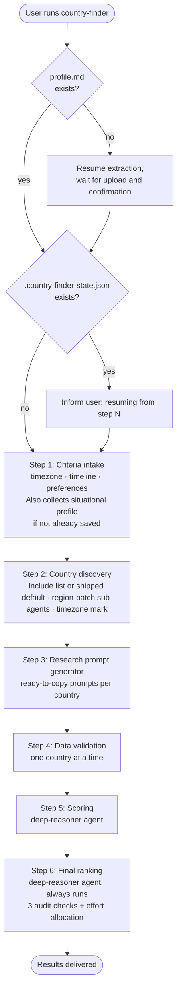

# country-finder

Runs the full Country Finder pipeline. Collects your criteria, discovers candidate countries for remote hire and visa sponsorship as two separate tracks, generates per-country research prompts, validates and stores your results, scores each country against your requirements, and produces a final priority ranking. Resumes from the last completed step if interrupted.

## Usage

Claude:

```
/agent-compass:country-finder
```

Codex: type `$` and select `country-finder` from Agent Compass, or use `/skills`. In the desktop app, select the skill from the composer. Both entry points run the same workflow.

Run it once per session. The assistant resumes automatically if a `.country-finder-state.json` file already exists.

See [shared workspaces and saved results]({{ '/docs/commands#shared-workspaces-and-saved-results' | relative_url }}) for missing checkpoints, changed profiles, imported results and run-only clarifications. Empty research results are accounted for rather than turned into invented fits.

For model choices, effort settings and approval, see [Specialist agents]({{ '/docs/specialist-agents.html' | relative_url }}).

Both hosts use shared Python 3.11+ helpers for batching, research ingestion, comparisons and final tables, with no extra packages. Research, fit and priority judgments remain with the assistant. If execution is unavailable, it asks before using the same rules manually. Existing profiles and checkpoints stay compatible; completed results are not rewritten.

## Flow



## Steps

The parent conversation owns user questions, state updates, and movement between steps. A delegated specialist completes only its assigned step and returns its saved output; the parent checks that output before continuing. After the final step, the parent presents the deliverable and ends the workflow.

### Profile check

Checks for `profile.md` in the workspace. If absent, reads `prompts/shared/resume-extraction-prompt.md`, waits for the user to provide their resume as an attachment, pasted text, or a readable local file, and waits for explicit confirmation of the extracted profile before continuing. The profile is reused on all subsequent runs without re-extraction.

### State check

Checks for `.country-finder-state.json`. If found, reads `last_completed_step` and informs the user which step will resume. If absent, creates the file with `last_completed_step: 0` and starts from Step 1. Updates the file only after each step and its required output are complete. Pending questions or partial research do not advance state. A run already at Step 6 reuses `cf-step6-final-ranking.md`. Invalid state or a missing final output is reported without overwriting it. The same workspace can be resumed on either host.

### [Step 1: Criteria intake](country-finder/step1-criteria-intake.html)

Collects requirements for both tracks. Remote track: maximum timezone difference (or "no limit" to skip). Sponsorship track: relocation timeline. Relocation is assumed; the question is not asked. Country preferences: countries or regions to include or exclude from both tracks. Vague answers require clarification. If the situational profile is absent, the parent asks the eight shared questions, including salary currency/gross-net basis, hard-floor versus context-only preference, work rights, and optional dated age. Existing profiles skip full intake; only material missing facts are clarified when a later check needs them.

### [Step 2: Country discovery](country-finder/step2-country-discovery.html)

Builds a single candidate universe: your Include list or the shipped default, confirmed with you before using the default. Research batches preserve regions where possible but never exceed 15 countries, with extra tasks queued rather than dropped. Remote and Sponsorship are checked separately. Timezone filtering accounts for relevant hubs and DST over the reference period; salary comparisons require compatible periods/pay bases and sourced FX where needed. Missing comparison evidence is unverified, not a rejection.

### [Step 3: Research prompt generator](country-finder/step3-research-prompt-generator.html)

Generates ready-to-copy research prompts for each candidate country on each track. Runs them as fresh-context research tasks when supported. If live web research or fresh conversation context is unavailable or cannot be established, it shows the prompts and waits for manually gathered results.

### [Step 4: Data validation](country-finder/step4-data-validation.html)

Reads `cf-step3-country-research.md` written by the parent from Step 3's subagent results and stores each country's data automatically. Validates each block: one country per block, all required fields present, duplicates skipped and noted. Data is preserved verbatim: no analysis, scoring, or summarizing during ingestion. Stored data is written to `cf-step4-country-data.md` for later steps.

### [Step 5: Scoring](country-finder/step5-scoring.html)

The assistant asks whether to use the **deep-reasoner** subagent (host-specific model and effort) for higher reasoning accuracy; if declined, the step runs with your current model. Scores each stored country against the criteria from Step 1, keeping remote hire and sponsorship tracks completely separate. Salary minimum check is only applied if a minimum was specified. Each country receives a fit classification (Strong / Moderate / Weak) and a confidence level (High / Medium / Low). Every excluded country requires a specific, evidence-based reason.

### [Step 6: Final Ranking](country-finder/step6-final-ranking.html)

Always runs after Step 5 completes; this is the only step in the pipeline with no skip option, since it produces the final result. The assistant asks whether to use the **deep-reasoner** subagent (host-specific model and effort); if declined, the step runs with your current model. Audits the scoring output across three checks (confidence calibration, a missing-candidate check, and an evidence-misuse check), then produces a five-column Priority Table: Country, Priority, Remote Fit, Sponsorship Fit, and Main limitation. Action priorities are Focus, Selective, Monitor, or Deprioritize; insufficient evidence without a usable track is Pending evidence, not a negative recommendation. Excluded and Unknown fits stay distinct, and a file-only Effort Allocation note expands the same priorities into practical effort.

## Stop conditions

- **Profile not yet uploaded.** The assistant waits; it does not proceed or fill in placeholder data.
- **Any step instructs the assistant to wait.** The assistant stops and waits. No guessing, no assumptions.
- **Vague answer to a criteria question.** The assistant asks again for a specific value before continuing.
- **Data validation finds an identifiable malformed block, missing fields, or an unlisted country.** It skips the item and records the reason in a consolidated report, also saved in the research file. Genuinely ambiguous block boundaries require clarification rather than guessed parsing.

## See also

- [`salary-calculator`](salary-calculator.html): calculate local-market salaries for countries discovered here
- [`portal-finder`](portal-finder.html): find verified job portals for a specific country
- [`job-screener`](job-screener.html): screen job descriptions against your resume profile
