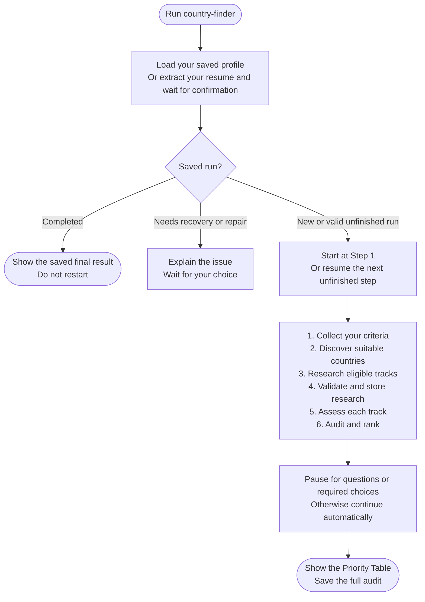

# country-finder

Finds countries worth targeting for remote work or employer-sponsored relocation, based on your profile and current evidence. The two paths are assessed separately.

## Start the command

```text
country-finder
```

Use the prefix for your app or terminal shown in [Setup]({{ '/docs/setup/' | relative_url }}). No country argument is needed.

Have your resume ready if you have not saved a profile yet. The assistant extracts it, waits for your confirmation and saves `profile.md` in your workspace.

## Flow



The numbered path shows a new run. An interrupted run continues from its next unfinished step.

## What to expect

[Criteria intake](country-finder/step1-criteria-intake.html) asks about your background, timezone preference, relocation timeline and countries to include or exclude.

[Country discovery](country-finder/step2-country-discovery.html) uses your include list first. Otherwise, it can offer countries saved by Salary Calculator for you to keep or edit, or you can choose the default list. Both paths are assessed independently of any salary results.

[Detailed research](country-finder/step3-research-prompt-generator.html) then covers only the tracks found suitable. If fresh-context browsing is unavailable, you receive research prompts and the assistant waits for results.

[Validation](country-finder/step4-data-validation.html) preserves accepted research and reports skipped data. [Scoring](country-finder/step5-scoring.html) assesses each track independently. The [final audit](country-finder/step6-final-ranking.html) checks the evidence and produces your Priority Table.

Scoring and the final audit may offer a [specialist agent]({{ '/docs/specialist-agents.html' | relative_url }}). Declining keeps the step on your current model.

## Your result

The table shows each country's application priority, Remote Fit, Sponsorship Fit and main limitation. Missing evidence stays distinct from a weak fit or an exclusion.

The full audit is saved to `country-finder-06-final-results.md`. You can use its results as an optional starting point for [salary-calculator](salary-calculator.html), or choose a country for [portal-finder](portal-finder.html).

Interrupted runs use `.country-finder-state.json` to resume.
