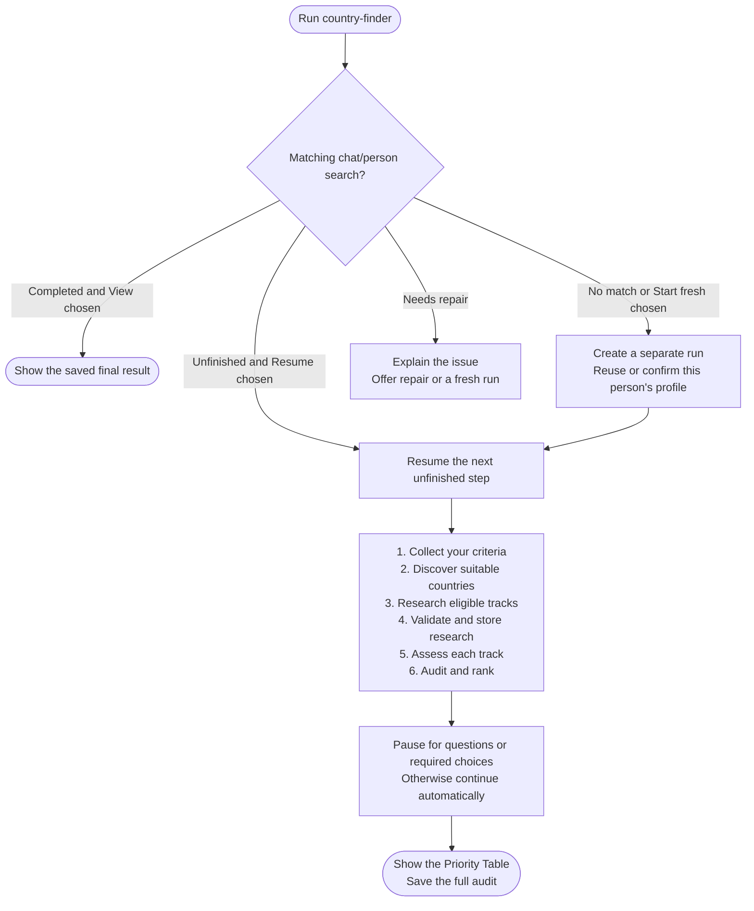

# country-finder

Find countries worth targeting for remote work or employer-sponsored relocation. Each path is assessed separately against your profile and current evidence.

## Start the command

```text
country-finder
```

Use the prefix from [Setup]({{ '/docs/setup/' | relative_url }}#run-a-command). No country argument is needed. If you have no saved profile, provide your resume and confirm the extraction before it is saved.

## Flow



New chats start fresh. In the same chat, a matching completed search offers View previous results / Start fresh; an unfinished search offers Resume / Start fresh. Earlier searches are preserved. See [Searches and saved files](../setup/saved-searches.html).

## What to expect

1. [Criteria intake](country-finder/step1-criteria-intake.html): confirm your background, timezone preference, relocation timeline and country preferences.
2. [Country discovery](country-finder/step2-country-discovery.html): use your include list, confirm Salary Calculator's saved country names, or choose the default list.
3. [Research](country-finder/step3-research-prompt-generator.html): investigate eligible tracks with self-contained, separate research tasks. Without suitable research access, you receive prompts and wait for manual results.
4. [Validation](country-finder/step4-data-validation.html): preserve accepted research and report skips.
5. [Scoring](country-finder/step5-scoring.html): assess each track's fit and confidence.
6. [Final ranking](country-finder/step6-final-ranking.html): audit the evidence and assign application priorities.

Scoring and ranking can use an optional [specialist]({{ '/docs/specialist-agents.html' | relative_url }}). Declining keeps the required step on your current model.

## Your result

Chat shows the Priority Table: country, application priority, both fits and main limitation. Missing evidence stays distinct from weak fit or exclusion.

`country-finder-06-final-results.md` holds the full audit; `.country-finder-state.json` tracks progress. Results can inform [salary-calculator](salary-calculator.html), or you can choose a country for [portal-finder](portal-finder.html).
