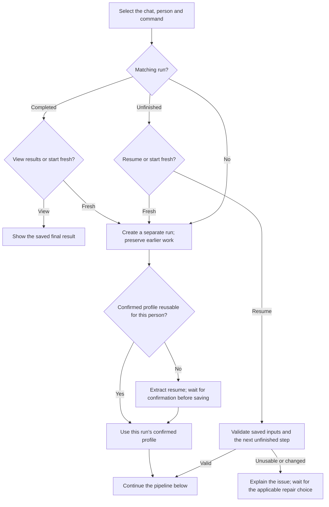
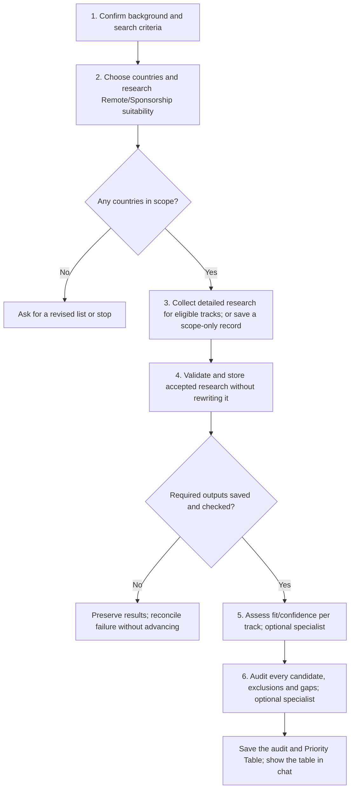

# country-finder



Find countries worth targeting for remote work or employer-sponsored relocation. Each path is assessed separately against your profile and current evidence.

## Flow

The run setup comes first. Saved results are replayed only after the matching chat and person have been established.

The six steps keep the two tracks independent. Exclusions and missing evidence still reach the final audit; an empty country scope needs a new list or a stop.

## Complete procedure

{{ page.guide_source | guide_full }}
