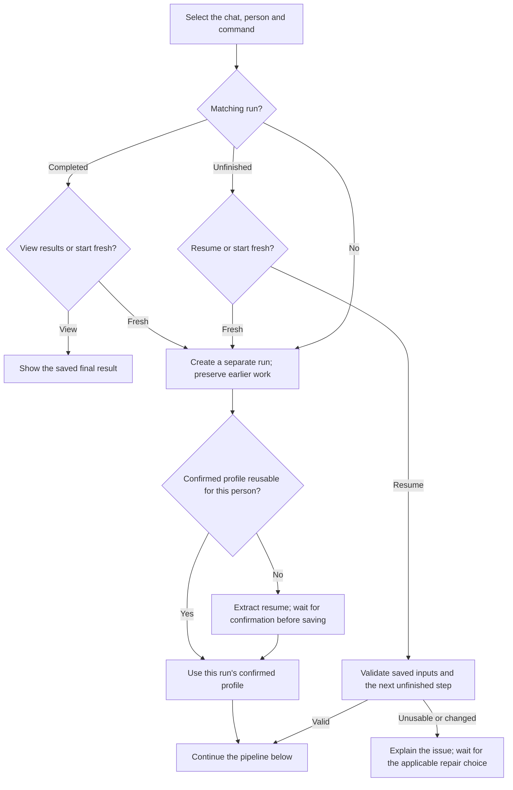
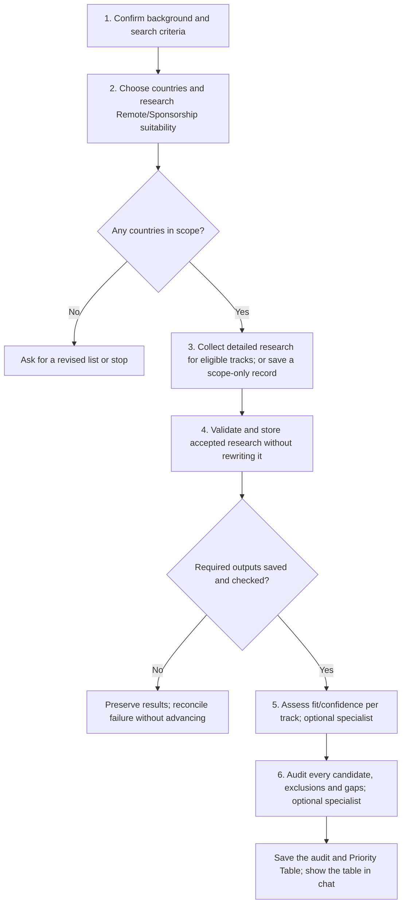

# country-finder



Country Finder helps decide where to spend your application effort. It investigates cross-border Remote work and employer-sponsored relocation separately, then turns the evidence into priorities for your confirmed profile.

## Flow

## Start the command

Run country-finder in a chat for the person being assessed. If a profile is missing, provide a resume and confirm the extraction before research continues. Relevant situational facts are confirmed separately rather than guessed from job titles or nationality.

A new chat starts a fresh search. In the same chat, a completed matching search offers View previous results or Start fresh; an unfinished search offers Resume or Start fresh. Earlier runs remain preserved, and another person's profile is not selected by recency.

## What to expect

### Confirm the criteria and country scope

[Criteria intake](step1-criteria-intake.html) clarifies role, timezone tolerance, relocation timing and include/exclude preferences. Your own country list comes first. Without one, [Country discovery](step2-country-discovery.html#choosing-countries) can offer Salary Calculator's saved country names for confirmation or show the default list.

That optional transfer uses names only. An unfinished salary search or a skipped salary estimate does not remove a country from the offer, and salary conclusions are not silently inherited.

### Investigate the two tracks independently

Remote evidence must apply to hiring someone in your actual working location. A company's domestic work-from-home policy does not establish cross-border hiring or pay. Sponsorship needs an employer-sponsored route and relevant willingness to hire; nomad or self-sponsored routes do not satisfy that track.

[Detailed research](step3-research-prompt-generator.html) follows tracks found eligible at discovery. Research tasks receive the needed profile facts directly and are kept separate from each other. If suitable research access is unavailable, you receive prompts and the workflow waits for supplied results rather than inventing findings.

### Validate, assess and audit

[Validation](step4-data-validation.html) checks structure and preserves accepted research unchanged. It does not certify the truth of every claim. [Scoring](step5-scoring.html) assigns categorical fit and confidence independently to each supported track.

The [final audit](step6-final-ranking.html) checks missing candidates, confidence and misuse of evidence before assigning priorities. Optional specialists can perform scoring or the audit; declining one leaves the required work on the current model.

## Your result

Chat shows a Priority Table with each country, application priority, both track fits and the main limitation. The saved final report contains the fuller audit and effort guidance. Unknown evidence, a known Weak fit and an explicit Exclusion remain different outcomes.

For example, strong Remote evidence can justify pursuing a country while Sponsorship remains unknown. That is not a reason to invent a sponsorship fit. When neither track supports a positive assessment and evidence is missing, Pending evidence is more accurate than a negative ranking.

A nonempty country scope can still reach an audit when no tracks receive detailed research: exclusions and gaps are accounted for without fabricated scores. An empty country list instead needs a revised scope or a stop.

The final Summary records the audited fits. Salary Calculator can use compatible results for its own country selection; [Portal Finder](../portal-finder.html) can help find job boards for one chosen country. Neither follow-up happens automatically.

## Explore the source

For implementation details, read [workflows/country-finder.md](https://github.com/myowinthein/agent-compass/blob/main/workflows/country-finder.md).
