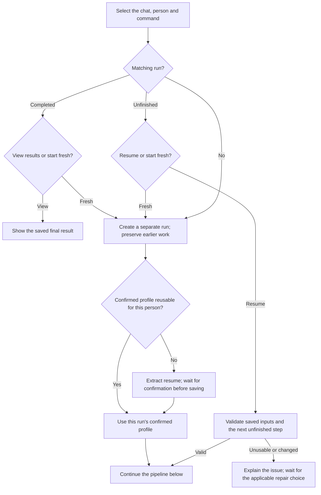
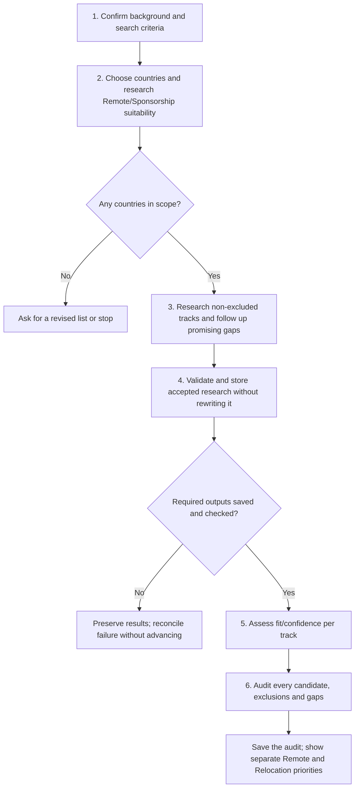

# Country finder



Country Finder helps decide where to spend your application effort. It investigates cross-border Remote work and employer-sponsored relocation separately, then turns the evidence into priorities for your confirmed profile.

## Flow

The first diagram selects the run and confirms its profile. Fresh runs then start the pipeline in the second diagram; resumed runs return to the next unfinished step. Viewing saved results ends without new research.

### Run selection and profile

### Research, assessment and ranking

## Start the command

Run country-finder in a chat for the person being assessed. The assistant uses an established identity or the name in your supplied resume; a separate label is needed only when identity is missing or unclear. In a chat with several people, identify whose search you want so their profiles stay separate.

If a profile is missing, review the extracted resume and reply **yes** to save the version shown, or give corrections. A revised profile is shown before its save decision; approving an unchanged version does not trigger another full review. Relevant situational facts are confirmed separately rather than guessed from job titles or nationality.

A new chat starts a fresh search. In the same chat, a completed matching search offers View previous results or Start fresh; an unfinished search offers Resume or Start fresh. Earlier runs remain preserved, and another person's profile is not selected by recency.

## What to expect

### Confirm the criteria and country scope

[Criteria intake](step1-criteria-intake.html) clarifies role, accepted working languages, timezone tolerance and any firm relocation deadline. One country question chooses the scope: your own countries are used exactly, while no preference leads to the displayed, editable default list in [Country discovery](step2-country-discovery.html#choosing-countries). No extra countries are automatically suggested.

You can explicitly request Salary Calculator's saved country names instead. That transfer uses names only: an unfinished salary search or a skipped estimate does not remove requested countries, and salary conclusions are not inherited.

### Investigate the two tracks independently

Remote evidence must apply to hiring someone in your actual working location. A company's domestic work-from-home policy does not establish cross-border hiring or pay. Sponsorship needs an employer-sponsored route and relevant willingness to hire; nomad or self-sponsored routes do not satisfy that track.

[Detailed research](step3-research-prompt-generator.html) follows every non-excluded track, including those where discovery found no evidence. It compares demand, personal fit, access and pay consistently, then follows up decision-changing gaps in promising markets. Research tasks receive the needed profile facts directly and are kept separate from each other. If suitable research access is unavailable, you receive prompts and the workflow waits for supplied results rather than inventing findings.

### Validate, assess and audit

[Validation](step4-data-validation.html) checks structure and preserves accepted research unchanged. It does not certify the truth of every claim. [Scoring](step5-scoring.html) assigns categorical fit and confidence independently to each supported track.

The [final audit](step6-final-ranking.html) checks missing candidates, confidence and misuse of evidence before assigning priorities. Scoring and the audit stay on your current model and effort. The workflow continues directly between these steps unless it needs a material clarification or repair decision.

## Your result

Chat shows independently ordered Remote and Relocation tables. Each gives the country, priority, fit, confidence, main limitation and next action. The saved report retains the fuller market comparison, audit and effort guidance. Unknown evidence, a known Weak fit and an explicit Exclusion remain different outcomes.

For example, a close role match and recurring hiring can justify Investigate next while the employer's Thailand eligibility or comparable pay is unresolved. Supported fit stays visible without implying an application-ready recommendation. Weak relocation evidence can receive Deprioritize even when Remote remains Pending evidence.

Only explicit exclusions skip detailed research. Incomplete tasks need recovery; completed searches can still finish with documented unresolved findings. Fully excluded tracks remain accounted for, and an empty country list needs a revised scope or a stop.

The final Summary records the audited fits. Salary Calculator can use compatible results for its own country selection; [Portal Finder](../portal-finder.html) can help find job boards for one chosen country. Neither follow-up happens automatically.

## Explore the source

For implementation details, read [workflows/country-finder.md](https://github.com/myowinthein/agent-compass/blob/main/workflows/country-finder.md).

The shared [assessment framework](https://github.com/myowinthein/agent-compass/blob/main/skills/country-assessment-rules.md) defines the evidence factors and verification distinctions.

The [run-selection rules](https://github.com/myowinthein/agent-compass/blob/main/skills/run-workspaces.md) and [resume intake prompt](https://github.com/myowinthein/agent-compass/blob/main/prompts/shared/resume-extraction-prompt.md) define identity handling and profile confirmation.
