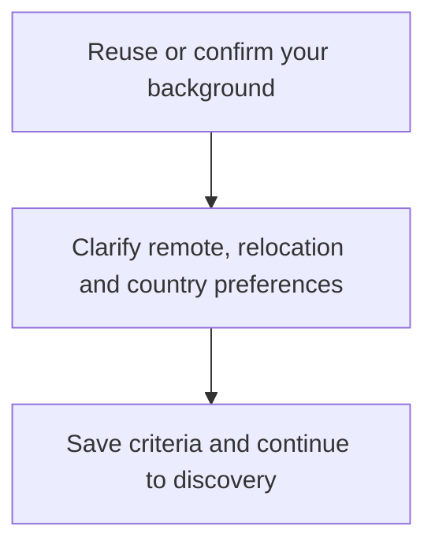

# Step 1: Criteria intake



Collect your background and preferences before researching either track.

## Flow

## Your background

The assistant reuses confirmed resume and situational facts, asking only for relevant gaps in location, citizenship, languages or work rights. It researches general immigration restrictions itself. You can supply a salary floor; only then are its currency and pay basis needed. Age is asked later only if a specific official rule makes it relevant, and you may decline.

Only unclear target roles, seniority or material facts need clarification.

## Your preferences

- Remote: maximum time difference, or "no limit".
- Sponsorship: an optional firm relocation deadline; "no fixed deadline" is valid.
- Preferred countries/regions and exclusions, or "none". Say **only these countries** to restrict the search; otherwise other promising markets can be suggested.

Settled answers are reused. Optional salary and deadline details can remain unspecified; clarification is needed only when it changes a comparison, eligibility or what happens next. [Step 2](step2-country-discovery.html#choosing-countries) confirms additions for open searches. Without preferred countries, it can offer saved Salary Calculator names before the default list.

## What happens next

The assistant saves criteria to `country-finder-01-criteria.md` and any new situational profile to `situational-profile.md`, then continues to [Country discovery](step2-country-discovery.html).
