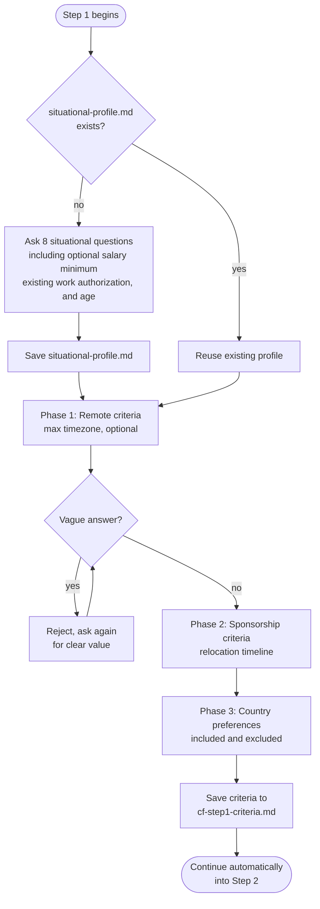

# Step 1: Criteria intake

Collects your hard requirements for both tracks before any research begins. The assistant stops and waits only while asking questions; once everything is answered and saved, it continues straight into Step 2 within the same response, without waiting for a new message.

## Flow

## What it reads

- `profile.md`: your resume profile (must exist before this step runs)
- `situational-profile.md`: if present, reused without re-asking; if absent, the assistant collects it here

## Situational profile

If `situational-profile.md` does not exist, the assistant asks eight questions and saves the answers to that file:

1. Current location
2. Citizenship
3. Any known immigration friction tied to that citizenship
4. Languages spoken
5. Required work environment language
6. Minimum acceptable monthly salary and currency, plus whether it's a hard floor or context only, or "not specified" to skip salary filtering
7. Existing residency or work authorization in any target country, and status there (independent work rights, a visa requiring sponsorship to change jobs, student visa, etc.), or "not applicable"
8. Date of birth or current age, since some visa salary thresholds vary by age, or "prefer not to say" to skip age-based threshold checks

These answers persist across sessions and are reused across workflows. Salary comparisons align currency, period, and gross/base versus net/take-home basis; only a hard floor can justify a minimum-pay rejection, and an unverified comparison is not a failure. Existing residency/work authorization informs both threshold categories and relocation friction. A supplied age is dated, and age/status-dependent visa thresholds are checked against the official category. Unknown or declined age is not guessed; an unconfirmable applicable figure stays Unknown. Existing profiles are reused, with only material missing details clarified when needed.

## Criteria questions

The assistant asks all questions before proceeding. Vague answers are rejected; the assistant asks again until it receives a specific value or an explicit "no limit" / "not specified."

**Remote track**
- Maximum time zone difference from your current location, or "no limit" to skip timezone filtering

**Sponsorship track**
- Timeline or urgency for relocating (e.g. "within 12 months," "no rush")

Relocation is assumed; the assistant does not ask whether you are open to relocating.

**Country preferences**: asked as two separate questions, not one combined free-text answer, so there's no ambiguity in classifying your reply
- Countries or regions to include
- Countries or regions to exclude

## Output

- `cf-step1-criteria.md`: criteria answers (timezone limit, relocation timeline, country preferences) written after all phases are complete. The assistant confirms the save in one line rather than repeating the criteria back; you just gave them, so there's nothing new to show.
- `situational-profile.md`: written here if it did not already exist; reused by subsequent steps and the Salary Calculator pipeline

## Stop condition

The assistant only stops while the situational-profile and criteria questions are still being asked; vague answers are rejected and re-asked. Once every phase is answered and the criteria file is saved, the assistant continues automatically into Step 2 within the same response, without waiting for a new message.
