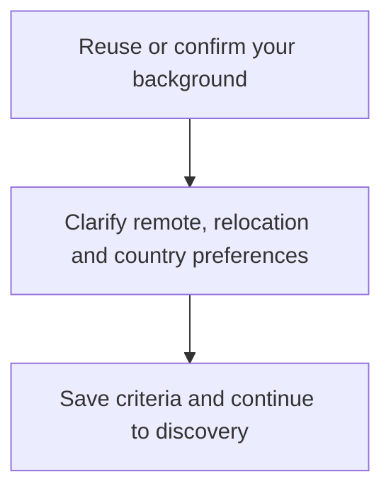

# Step 1: Criteria intake



Collect your background and preferences before researching either track.

## Flow

## Your background

The assistant reuses confirmed facts, asking only for relevant gaps. Citizenship/passport nationality and existing country-specific status or work rights are separate. One language question asks which languages you are willing and able to use at work. A salary floor is optional; its currency and pay basis are needed only when supplied. Age is asked later only if a specific official rule makes it relevant, and you may decline.

Only unclear target roles, seniority or material facts need clarification.

## Your preferences

- Remote: maximum time difference, or "no limit".
- Sponsorship: an optional firm relocation deadline; "no fixed deadline" is valid.
- Countries/regions to research, or the default list. A supplied list is used exactly; removals are handled as list edits rather than a separate exclusion question.

Settled answers are reused. Optional salary and deadline details can remain unspecified. [Step 2](step2-country-discovery.html#choosing-countries) shows the full default list for acceptance or editing when no countries are supplied; clear custom lists need no second approval. Saved Salary Calculator names are available on explicit request.

## What happens next

The assistant saves criteria to `country-finder-01-criteria.md` and any new situational profile to `situational-profile.md`, then continues to [Country discovery](step2-country-discovery.html).
