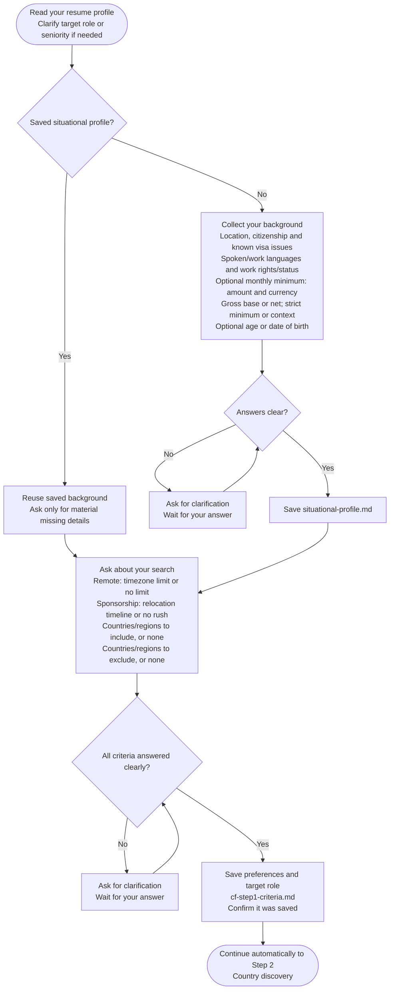

# Step 1: Criteria intake

Collects your preferences before researching countries for remote work or visa sponsorship.

## Flow

## Your background

If you already have a saved situational profile, it is reused. Otherwise, the assistant asks about:

- Your current location, citizenship and any known visa complications.
- Languages you speak and want to use at work.
- Existing work rights or immigration status.
- Minimum monthly salary and currency, whether it is before or after tax and whether it is a strict minimum or just context.
- Age or date of birth for age-dependent visa salary rules.

You can skip the salary minimum or choose not to share your age. If your target role or seniority is unclear, it asks you to clarify.

## Your preferences

- Remote work: the maximum time difference you accept from your current location, or "no limit".
- Visa sponsorship: your relocation timeline, such as "within 12 months" or "no rush".
- Countries or regions you want included, or "none".
- Countries or regions you want excluded, or "none".

If an answer is unclear, the assistant asks for clarification before continuing.

## What happens next

Your preferences are saved to `cf-step1-criteria.md`. A new situational profile is saved to `situational-profile.md` for reuse.

The workflow then continues to [Step 2: Country discovery](step2-country-discovery.html).
