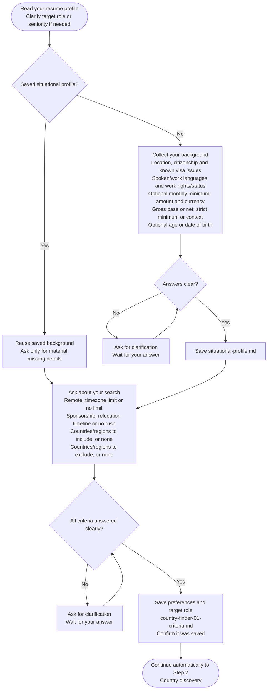

# Step 1: Criteria intake

Collect your background and preferences before researching either track.

## Flow

## Your background

Saved situational facts are reused. Otherwise, provide location, citizenship, known visa issues, languages and work rights/status. An optional salary minimum needs currency, gross/net basis and a hard-floor or context-only choice. Age or birth date supports age-dependent visa rules; you may decline disclosure.

Only unclear target roles, seniority or material facts need clarification.

## Your preferences

- Remote: maximum time difference, or "no limit".
- Sponsorship: relocation timeline, including "no rush".
- Countries/regions to include and exclude, or "none".

Unclear answers need clarification. Without an include list, Step 2 can offer saved Salary Calculator countries for confirmation before the default list.

## What happens next

The assistant saves criteria to `country-finder-01-criteria.md` and any new situational profile to `situational-profile.md`, then continues to [Country discovery](step2-country-discovery.html).
