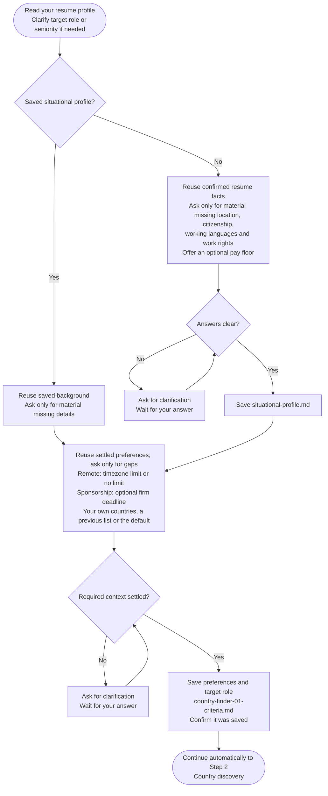

# Step 1: Criteria intake



Criteria intake turns your background and preferences into a usable research brief. It separates facts about the candidate from choices about the search, so later findings can explain why each track fits or does not.

## Flow

## Your background

The confirmed resume profile supplies experience, role and seniority, plus any applicable location, citizenship or language facts it already contains. These are reused even when no separate situational profile exists. A known fact does not need another question merely to populate a new file.

Missing situational context can include location, passport nationality and country-specific status or work rights. Citizenship, permanent residence and visas are recorded with relevant work conditions; a status label does not automatically mean unrestricted work permission. Known citizenship is reused without asking for it twice. Unknown conditions stay unknown.

One question asks which languages you are willing and able to use as the main working language. It avoids a separate inventory of every spoken language, while retaining those already in the resume. Proficiency needs clarification only when it can change the assessment. Research checks actual workplaces; a country's official language alone is not a reason to exclude it.

A salary floor is optional. If you supply one, its amount, currency and gross/net basis are needed for a valid comparison. A contextual preference is preserved without becoming an exclusion; the agent clarifies that distinction only when ambiguous. Leaving the amount unspecified does not create a zero floor or prevent discovery.

The agent researches general immigration restrictions and employer evidence rather than asking you to judge citizenship-related risk. A personal circumstance may need a targeted question when relevant. Age is deferred until an official rule could change an assessed route or salary category; the question explains why it matters and requests only the necessary detail. You may decline, leaving that check conditional.

## Your preferences

Remote uses your maximum time difference, or **no limit**. Sponsorship can use an optional firm relocation deadline. For example, a route requiring six months cannot be a Focus recommendation for a confirmed two-month deadline, even if its role match is strong. No fixed deadline or unspecified timing adds no timing penalty. These constraints remain separate: a timezone limit affects Remote, while a relocation deadline affects Relocation.

One question asks which countries the search should cover. A supplied answer such as **Germany** means Germany only, with no extra suggestions. Without supplied countries, intake can offer countries from the previous Country Finder or Salary Calculator search for the same person in this chat, or your own list or the default. Every proposed country appears before the reuse choice, with long lists outside the question panel. Exclusions are removals from that list, not a separate questionnaire. Clear supplied lists need no duplicate approval; ambiguous region boundaries need clarification.

For example, a preference for Europe does not tell the researcher whether you mean the European Union (EU), the European Economic Area (EEA) or a broader region. Resolving that once is more useful than silently choosing a definition for every later step.

## What happens next

The agent saves the criteria and any newly confirmed situational profile, then continues to [Country discovery](../step2-country-discovery.html#choosing-countries).

Discovery uses the chosen scope and researches both tracks without repeating a settled country question. A previous list transfers names only, including countries later excluded or skipped. Choosing the default shows its full list for acceptance or editing. A confirmed search scope and its source are retained on resume.

Material changes later can require revisiting affected research. Earlier files and decisions are preserved rather than relabeled as if they were produced from the new profile.

## Explore the source

For implementation details, read [prompts/country-finder/step1-criteria-intake.md](https://github.com/myowinthein/agent-compass/blob/main/prompts/country-finder/step1-criteria-intake.md).

The shared [situational intake](https://github.com/myowinthein/agent-compass/blob/main/skills/situational-profile-questions.md) defines fact reuse, optional answers and conditional follow-up.

The shared [country-selection rules](https://github.com/myowinthein/agent-compass/blob/main/skills/country-selection.md) define the common previous-list, own-list and default choices.
