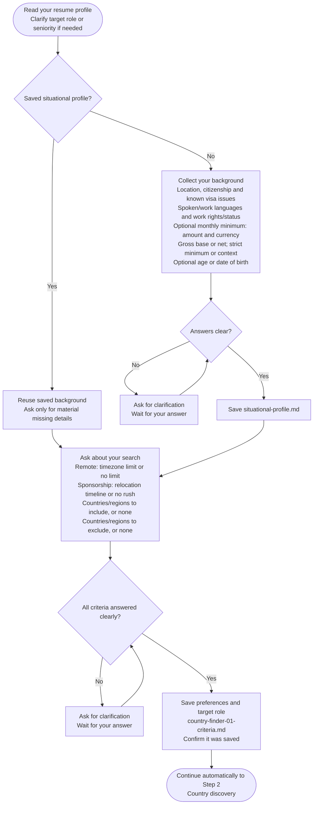

# Step 1: Criteria intake



Criteria intake turns your background and preferences into a usable research brief. It separates facts about the candidate from choices about the search, so later findings can explain why each track fits or does not.

## Flow

## Your background

The confirmed resume profile supplies professional experience, role and seniority. Saved situational facts are reused; the agent asks only for material gaps or ambiguity rather than extracting the same resume repeatedly.

Situational context includes location, citizenship, known immigration issues, languages and existing work rights. A country where you can already work may need different analysis from one where an employer must obtain sponsorship. Unknown status remains unknown instead of becoming assumed eligibility.

An optional salary minimum needs an amount, currency and gross/net basis, plus whether it is a hard floor or context only. An unexplained number cannot support a valid exclusion. Age or birth-date context can help with age-dependent routes, but disclosure may be declined and the resulting limitation must remain visible.

## Your preferences

Remote uses your maximum time difference, or **no limit**. Sponsorship uses your relocation timeline, including **no rush**. These choices constrain different tracks; a timezone restriction should not become a relocation exclusion.

State countries or regions to include and exclude, or say none. Clear choices do not need a duplicate confirmation, while vague regions and contradictory boundaries require clarification before they become the candidate scope.

For example, a preference for Europe does not tell the researcher whether you mean the EU, the EEA or a broader region. Resolving that once is more useful than silently choosing a definition for every later step.

## What happens next

The agent saves the criteria and any newly confirmed situational profile, then continues to [Country discovery](../step2-country-discovery.html#choosing-countries).

Your own include list takes precedence. Without one, discovery can offer Salary Calculator's saved country names for your decision before using a default list. That offer transfers names only, not another workflow's salary or eligibility conclusions.

Material changes later can require revisiting affected research. Earlier files and decisions are preserved rather than relabeled as if they were produced from the new profile.

## Explore the source

For implementation details, read [prompts/country-finder/step1-criteria-intake.md](https://github.com/myowinthein/agent-compass/blob/main/prompts/country-finder/step1-criteria-intake.md).
