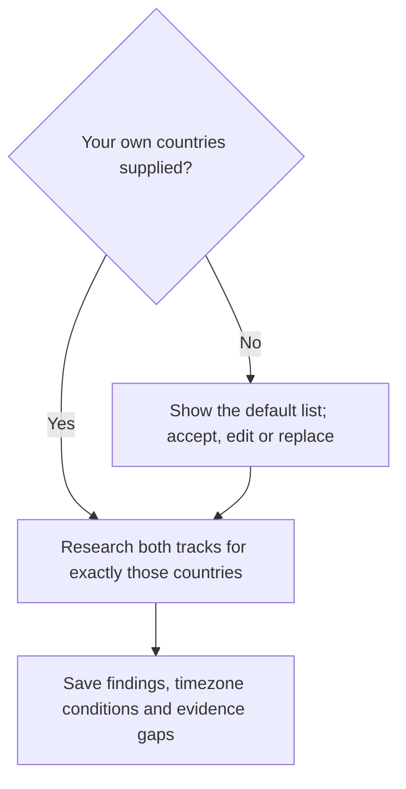

# Step 2: Country discovery



Check which countries have evidence of remote hiring or employer-sponsored relocation for your role.

## Flow

## Choosing countries

Your supplied countries are the exact scope: **Germany** means Germany only. No extra countries are automatically suggested or added.

With no countries in mind, you see the full default list grouped by continent before choosing to use, edit or replace it. The assistant waits for your answer before researching each country's suitability. Remove countries or add your own within this choice; there is no separate exclusion question. The default does not claim worldwide coverage.

You can explicitly request [Salary Calculator](../salary-calculator/step1-research-prompt-generator.html#what-happens-next)'s saved research scope. Salary research need not be complete: only country names are reused, including targets whose salary data was skipped. No salary or visa conclusions transfer. Missing scope leaves your own list or the default available.

Regions expand before requested removals apply. Clear supplied or already confirmed lists need no second approval; ambiguous boundaries do. Resumes keep the saved scope.

## What gets checked

- **Remote:** hiring, pay and engagement evidence applicable to your working location. Domestic remote policies do not prove cross-border hiring.
- **Sponsorship:** a named employer-sponsored route and relevant hiring evidence. Nomad/self-sponsored visas do not qualify, and sponsor registration alone proves no willingness to hire.

Each country is checked for role-specific demand, personal fit and hiring access. Shortage lists are useful signals, not proof of sponsorship or an offer. Dated sources support each finding. Missing evidence is not rejection and continues to detailed research. Only a valid comparison proving pay below a hard floor can cause a salary-based Remote exclusion.

## Timezone preference

Unless you specify another period, relevant employment hubs are checked over the next 12 months, including daylight saving time changes. Partial passes retain conditions; uncertain coverage stays unverified.

This affects Remote only and is skipped for "no limit".

## What happens next

`country-finder-02-candidates.md` saves the scope and findings; chat shows counts. Once results are complete, continue to [Detailed research](step3-research-prompt-generator.html).
