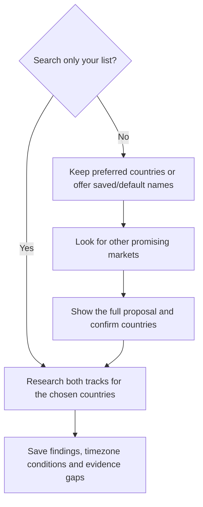

# Step 2: Country discovery



Check which countries have evidence of remote hiring or employer-sponsored relocation for your role.

## Flow

## Choosing countries

Countries you would like included are preferences. The assistant keeps them and looks for other markets with relevant demand or hiring leads. Saying **only these countries** restricts the search to your list.

For an open search, you see the proposed additions and their reasons before choosing the full research list. Keep, edit or replace the proposal, or use only the starting countries. The assistant waits for your answer before researching each country's suitability.

Without preferred countries, [Salary Calculator](../salary-calculator/step1-research-prompt-generator.html#what-happens-next)'s saved research scope can supply starting names before the default list. Source reuse and the proposed scope share one country-choice question.

Salary research need not be complete: only country names are reused, including targets whose salary data was skipped. No salary or visa conclusions transfer. Missing scope leaves your own list or the default available.

When offering the default, the assistant first prints every country grouped by continent in chat, with any additions shown separately. The default is a starting list, not a claim that other countries lack potential.

Regions expand before exclusions apply, and excluded countries are never added back as suggestions. Clear restricted or already confirmed lists need no second approval; ambiguous boundaries do. Resumes keep the saved scope. If live discovery is unavailable, you can supply evidence or choose a disclosed starting-list-only search.

## What gets checked

- **Remote:** hiring, pay and engagement evidence applicable to your working location. Domestic remote policies do not prove cross-border hiring.
- **Sponsorship:** a named employer-sponsored route and relevant hiring evidence. Nomad/self-sponsored visas do not qualify, and sponsor registration alone proves no willingness to hire.

Each country is checked for role-specific demand, personal fit and hiring access. Shortage lists are useful signals, not proof of sponsorship or an offer. Dated sources support each finding. Missing evidence is not rejection and continues to detailed research. Only a valid comparison proving pay below a hard floor can cause a salary-based Remote exclusion.

## Timezone preference

Unless you specify another period, relevant employment hubs are checked over the next 12 months, including daylight saving time changes. Partial passes retain conditions; uncertain coverage stays unverified.

This affects Remote only and is skipped for "no limit".

## What happens next

`country-finder-02-candidates.md` saves the scope and findings; chat shows counts. Once results are complete, continue to [Detailed research](step3-research-prompt-generator.html).
