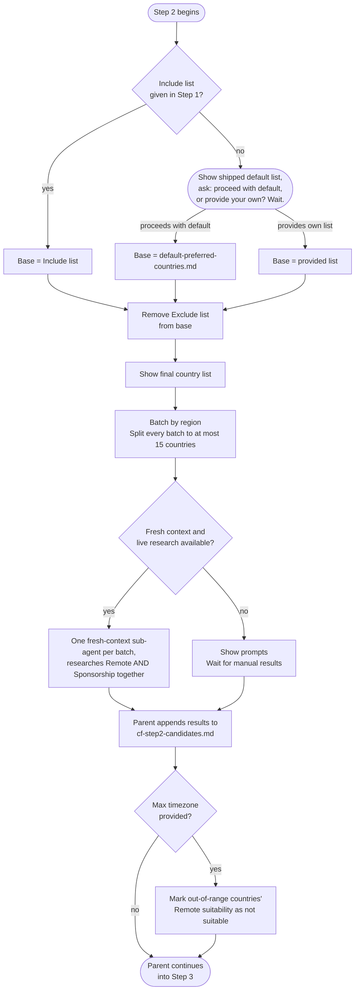

# Step 2: Country discovery

Builds a single candidate universe, then runs fresh-context research sub-agents (one per region batch) to check each country for both Remote and Sponsorship suitability together. No country is included based on reputation alone; every finding must be traceable to a real, checkable source.

## Flow

## What it reads

- Criteria and preferences from Step 1 (`cf-step1-criteria.md`)
- `profile.md` and `situational-profile.md`
- `data/default-preferred-countries.md`, shipped with the plugin, read only if no Include list was given

## Part A: Build the candidate universe

No research needed; pure filtering logic, applied immediately:

1. **Base list**: the Step 1 Include list if one was given; otherwise the assistant shows you the shipped `data/default-preferred-countries.md` grouped by continent and asks whether to proceed with it or provide your own countries instead, waiting for your answer either way.
2. If an Exclude list was given, those countries are removed from the resulting base.

Except for the default-list question or a material region clarification, this happens without a redundant confirmation. The resulting final country list is shown before research begins.

Regions are expanded to explicit countries, with a targeted question for an ambiguous boundary. A clear list you supplied already confirms the scope. The list is saved before research so an interrupted batch cannot disappear on resume. If exclusions leave no countries, you choose a revised list or stop.

## Part B: Research sub-agents

The final list is batched by region when using the shipped list, but any region over 15 countries is split into numbered sub-batches of at most 15. Lists without usable region grouping are split in list order with the same size limit. There is no total batch cap: tasks are queued within the host's concurrency limit without dropping countries. When fresh task context and live research are available, one researcher handles each batch.

Each sub-agent's prompt embeds, as literal text (never by reference), the exact countries in its batch, the candidate's target role and skillset from `profile.md`, the minimum monthly salary from `situational-profile.md` (if specified), and the candidate's citizenship and any noted immigration friction. This keeps the prompt self-contained without relying on the parent's conversation. Researchers are instructed not to read workspace files or other researchers' results; fresh conversation context does not guarantee filesystem isolation.

Each agent checks **both** tracks for every country in its batch, not just one track:

Briefs also carry the relevant location, settled level, dated experience, languages and stated work status. Remote evidence must apply to hiring someone working from that location, with the engagement and pay basis identified. A local remote job can qualify when you already live there; domestic-only evidence is not cross-border evidence. Language findings are role-specific, not assumptions about a whole country.

**Remote suitability**: is remote hiring for this role a common, well-established practice? If a salary minimum was specified, does typical remote pay meet it? Evidence from remote job boards, hiring reports, salary surveys, or company remote policies.

Salary-minimum checks use comparable currency, period, and gross/net basis. A different-currency minimum is converted for comparison only with a dated, sourced FX quote recorded in the findings; missing conversion evidence is unverified, not an exclusion. Context-only minima are not hard filters.

**Sponsorship suitability**: does a real, named work-visa pathway exist *where a local employer is the sponsor*, a standard employer-sponsored visa or work permit tied to a job offer? Digital-nomad, remote-worker, long-stay, or self-qualifying visas don't count, even if prominent in search results; they don't involve a local employer sponsoring the candidate. Is the occupation on a shortage list? That's a positive factor (and a hard requirement only for the minority of visas that explicitly say so); its absence alone doesn't disqualify a country unless the identified pathway requires it. Citizenship-specific friction is factored in. Evidence from official immigration sources, visa program pages, or recruiter guides. A visa's salary threshold is noted as a fact, never used by itself to decide suitability; that judgment against real market data happens later, in Step 5.

Each researcher is instructed to prefer sources in order: official government immigration/labour sources, direct employer pages, official sponsor/accredited-employer registers (capability only, not intent), specialist job boards/recruiters/salary surveys, then aggregators and search snippets (which need direct verification). Each country gets independent Suitable / Reason / Source (name and URL) / Date findings for each track; "no evidence found" is reported explicitly rather than guessed. Before delegation, the parent checks that fresh conversation context and live web research are available. If either capability is unavailable or cannot be established, it shows all batch prompts and waits for you to bring back results manually. Researchers return findings for their assigned batch only; the parent writes the aggregate research file.

## Part C: Timezone marking

If a maximum difference was provided, the assistant records the candidate and target-hub zones, reference date, and seasonal differences. Unless you specified another work period, it assesses the next 12 months using simultaneous DST offsets and the maximum absolute difference. Multi-zone countries are assessed by relevant job hubs: only a supported failure across all assessed relevant locations rejects the whole Remote track. If some hubs pass, suitability is conditional on those locations; uncertain timezone evidence is marked unverified, not rejected. Sponsorship is unaffected, and "no limit" skips this filter.

## Output

- `cf-step2-candidates.md`: every researched country, with independent Remote and Sponsorship findings (suitability, reasoning, source, date). The assistant does not reproduce these per-country findings in chat; only a brief summary (countries researched, Suitable counts per track) and confirmation that the file is saved for Step 3.

## Stop condition

The parent waits at the default-list question, manual-research fallback, or any material candidate-location/pay-basis clarification. Unverifiable comparisons are never turned into invented rejections. Once required research is saved and Part C has run if applicable, the parent enters Step 3 without waiting for an extra continuation message.
