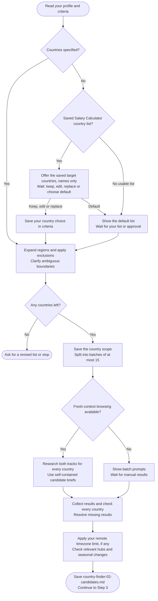

# Step 2: Country discovery

Checks which countries have a supported remote-hiring or employer-sponsored path for your role.

## Flow

## Choosing countries

Your include list is used first. Otherwise, the assistant can offer the countries you selected in [Salary Calculator](../salary-calculator/step1-research-prompt-generator.html#choosing-countries). You can keep the list, add or remove countries, provide a new list or choose Country Finder's default list. It waits for your answer before researching.

The suggestion comes from Salary Calculator's saved research scope, including countries whose salary data was later skipped. Salary research need not be complete, because only country names are reused, not salary figures or visa conclusions. If the original list is missing or unclear, you can provide countries or choose the default list instead.

Regions are expanded into countries, then exclusions are removed. A clear list you already supplied does not need another confirmation.

Your accepted saved-list or replacement choice is recorded in the existing criteria file. An interrupted run keeps its confirmed scope; later Salary Calculator changes do not replace it.

## What gets checked

- Remote: evidence of employers hiring your role from your current location, including pay and engagement type. Domestic-only remote listings do not prove cross-border hiring.
- Sponsorship: a named employer-sponsored work route and relevant hiring evidence. Digital-nomad and self-sponsored routes do not count.

Findings use dated sources, not country reputation. A sponsor register shows permission to sponsor, not willingness to hire you. Each track records suitability, reasoning, sources and dates; lack of evidence is not a confirmed rejection.

Salary-floor checks need comparable pay and a sourced exchange rate when currencies differ. Uncertain comparisons do not eliminate a country.

## Timezone preference

Unless you specified another period, the check covers the next 12 months, including daylight-saving changes. Multi-zone countries are assessed by relevant job hubs. Some passing hubs can keep Remote suitable with conditions; uncertain coverage stays unverified.

This filter affects Remote only. It is skipped when you chose "no limit".

## What happens next

Results are saved to `country-finder-02-candidates.md`. Chat shows a brief count rather than every finding.

Once all required results are collected, the workflow continues to [Step 3: Research prompt generator](step3-research-prompt-generator.html).
