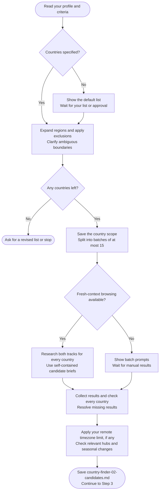

# Step 2: Country discovery

Checks which countries have a supported remote-hiring or employer-sponsored path for your role.

## Flow

## Choosing countries

Your include list is used first. If you did not provide one, the assistant shows the shipped default list and waits for your approval or an alternative.

Regions are expanded into countries, then exclusions are removed. A clear list you already supplied does not need another confirmation.

## What gets checked

- Remote: evidence of employers hiring your role from your current location, including pay and engagement type. Domestic-only remote listings do not prove cross-border hiring.
- Sponsorship: a named employer-sponsored work route and relevant hiring evidence. Digital-nomad and self-sponsored routes do not count.

Findings use dated sources, not country reputation. A sponsor register shows permission to sponsor, not willingness to hire you. Each track records suitability, reasoning, sources and dates; lack of evidence is not a confirmed rejection.

Salary-floor checks need comparable pay and a sourced exchange rate when currencies differ. Uncertain comparisons do not eliminate a country.

## Timezone preference

Unless you specified another period, the check covers the next 12 months, including daylight-saving changes. Multi-zone countries are assessed by relevant job hubs. Some passing hubs can keep Remote suitable with conditions; uncertain coverage stays unverified.

This filter affects Remote only. It is skipped when you chose "no limit".

## What happens next

Results are saved to `country-finder-02-candidates.md`. Chat shows a brief count rather than every finding.

Once all required results are collected, the workflow continues to [Step 3: Research prompt generator](step3-research-prompt-generator.html).
