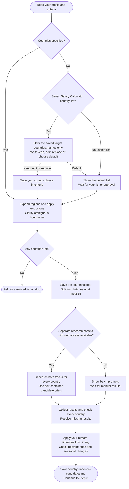

# Step 2: Country discovery

Check which countries have evidence of remote hiring or employer-sponsored relocation for your role.

## Flow

## Choosing countries

Your include list comes first. Otherwise, [Salary Calculator](../salary-calculator/step1-research-prompt-generator.html#choosing-countries)'s saved research scope can supply a proposed list. You can keep, edit, replace it or choose the default. The assistant waits for your answer before researching.

Salary research need not be complete: only country names are reused, including targets whose salary data was skipped. No salary or visa conclusions transfer. Missing scope leaves your own list or the default available.

Regions expand into countries before exclusions apply. Clear supplied lists need no second confirmation; ambiguous boundaries do. Accepted choices are saved in criteria and retained on resume.

## What gets checked

- **Remote:** hiring, pay and engagement evidence applicable to your working location. Domestic remote policies do not prove cross-border hiring.
- **Sponsorship:** a named employer-sponsored route and relevant hiring evidence. Nomad/self-sponsored visas do not qualify, and sponsor registration alone proves no willingness to hire.

Dated sources support each finding. Missing evidence is not rejection. Only a valid comparison proving pay below a hard floor can cause a salary-based Remote exclusion.

## Timezone preference

Unless you specify another period, relevant hubs are checked over the next 12 months, including DST. Partial passes retain conditions; uncertain coverage stays unverified.

This affects Remote only and is skipped for "no limit".

## What happens next

`country-finder-02-candidates.md` saves the scope and findings; chat shows counts. Once results are complete, continue to [Detailed research](step3-research-prompt-generator.html).
