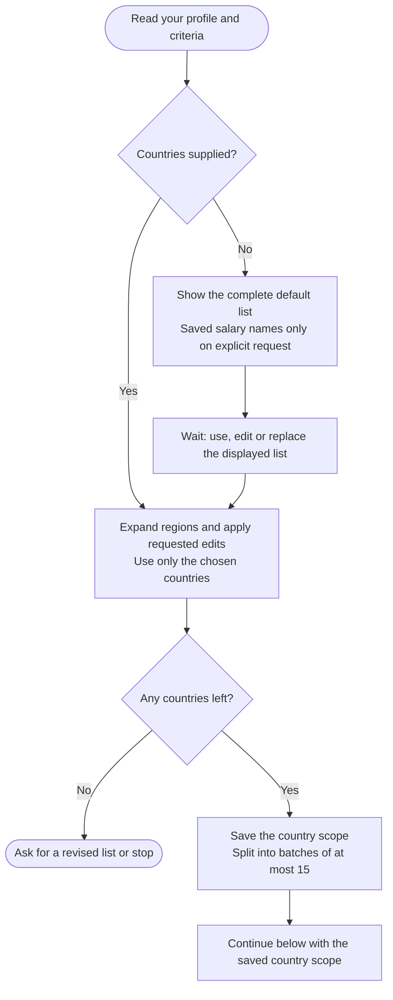
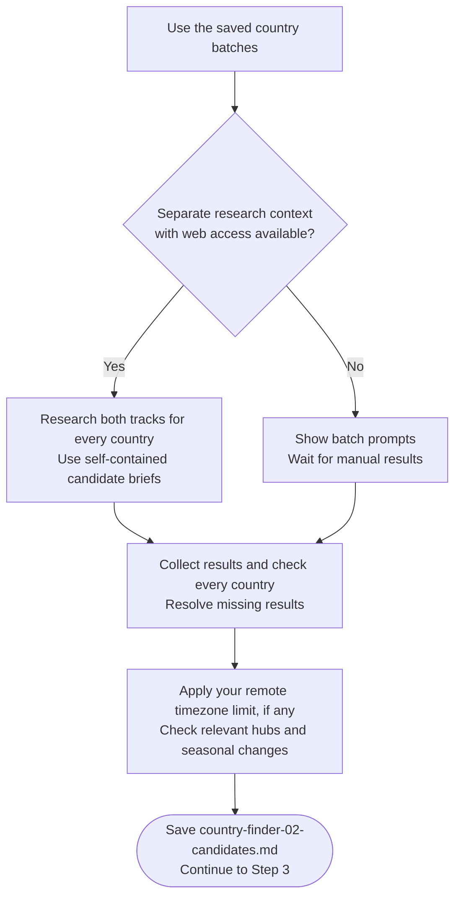

# Step 2: Country discovery



Discovery establishes the candidate countries and the evidence for each employment track. It identifies useful leads, constraints and gaps while preserving the difference between an explicit exclusion and information that has not been found.

## Flow

These are two stages of country discovery. The saved country scope at the end of the first diagram becomes the research batches at the start of the second. An empty scope needs revised countries or a stop before research.

### Country selection

### Research and timezone checks

## Choosing countries

A supplied list fixes the scope. For example, **Germany** means Germany only; it does not mean Germany plus the default list or automatically discovered alternatives. The same rule applies to a longer custom list. Region names are expanded, with clarification when their boundaries matter.

With no preference, the agent displays every default country grouped by continent. You can accept the list, remove countries, add others yourself or replace it. A request for the default before seeing it is not approval of an unseen list. Once reviewed and confirmed, it needs no duplicate question. A selected country is not silently removed because preliminary evidence is weak.

Saved Salary Calculator names remain an explicit alternative. If you request them, the agent offers the full recorded research scope, including targets whose salary data was skipped. Salary completion is unnecessary because only names transfer. Missing or declined source data leaves custom/default selection available; no salary or eligibility conclusions are inherited.

The confirmed scope is saved and retained on resume, including older runs. An older unfinished preference for open discovery without a confirmed full list needs a repair choice before the scope rule changes. Saved research is preserved. An empty selection needs revised countries or a stop before research.

## What gets checked

Research looks at Remote and Sponsorship together for each country, but reaches separate conclusions.

| Track | Evidence that matters |
|---|---|
| Remote | Cross-border hiring, engagement and pay arrangements applicable to your actual working location. |
| Sponsorship | A named employer-sponsored route and relevant evidence that employers hire candidates through it. |

Domestic work-from-home rules do not establish cross-border Remote access. Likewise, a nomad or self-sponsored visa is not an employer-sponsored route. Sponsor registration alone does not prove an employer is willing to hire this candidate.

Research compares occupation-level demand, job hubs and personal fit alongside access. One vacancy cannot establish a deep market, and one employer's refusal cannot exclude the whole country. A shortage listing is distinct from both an immigration occupation list and employer willingness.

Findings use dated sources and retain their limits. Missing evidence is not a rejection. A salary-based Remote exclusion needs a valid comparable range entirely below a confirmed hard floor; context-only minima or incomplete comparisons cannot support that decision.

## Timezone preference

Timezone suitability affects Remote only and is skipped for no limit. Unless you choose another period, the check covers relevant hubs over the next twelve months, including daylight-saving changes.

A country with multiple employment hubs can have mixed results. A partial pass keeps the relevant hub or seasonal condition; incomplete coverage remains unverified. One favorable timezone observed today does not establish a full-year result.

## What happens next

The candidate file records scope, track findings, reasons, timezone conditions and evidence gaps. Chat gives brief counts rather than the full research body.

[Detailed research](../step3-research-prompt-generator.html) covers both positive leads and no-evidence findings. Only explicit supported exclusions skip that track. An unpublished salary or employment arrangement leaves a question to investigate rather than ending research.

## Explore the source

For implementation details, read [prompts/country-finder/step2-country-discovery.md](https://github.com/myowinthein/agent-compass/blob/main/prompts/country-finder/step2-country-discovery.md).

The shared [assessment framework](https://github.com/myowinthein/agent-compass/blob/main/skills/country-assessment-rules.md) defines the evidence factors and verification distinctions.
