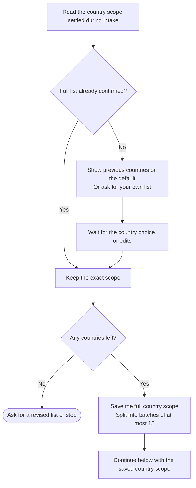

# Step 2: Country discovery



Discovery establishes the candidate countries and the evidence for each employment track. It identifies useful leads, constraints and gaps while preserving the difference between an explicit exclusion and information that has not been found.

## Flow

These are two stages of country discovery. The saved country scope at the end of the first diagram becomes the research batches at the start of the second. An empty scope needs revised countries or a stop before research.

### Country selection

### Research and timezone checks

## Choosing countries

Step 1 normally settles the full country list, so discovery starts with that scope. **Germany** means Germany only; the assistant does not append defaults or other markets. Regions are expanded before removals, with clarification when their boundaries matter.

For a fresh search without supplied countries, the previous Country Finder or Salary Calculator search for the same person in this chat can supply its full list. This works when switching commands or repeating either one. Starting fresh preserves that earlier list and its results. Another person’s or another chat’s history is not searched automatically.

The assistant names the source and shows every country before asking whether to reuse the list, choose other countries or use the default. Long lists stay outside the question panel, grouped where useful. You can also enter a replacement or request edits directly. An explicit default request takes precedence over a previous-list offer, and the full default is shown before its acceptance.

This is a names-only choice. Excluded, rejected, missing and skipped countries remain in the offered scope. Research need not be complete, and no market fit, salary or visa conclusion transfers. Missing scope leaves own/default choices available; ambiguous sources or country labels need clarification rather than guessed history.

Legacy Step 1 criteria with an unseen default or unresolved list use this same choice here. Already confirmed lists need no repeated approval. An older unfinished preference for open discovery without a confirmed scope still needs its repair choice. A resumed search preserves its recorded scope and source; an empty selection needs revised countries or stop.

## What gets checked

Research looks at Remote and Sponsorship together for each country, but reaches separate conclusions.

| Track | Evidence that matters |
|---|---|
| Remote | Cross-border hiring, engagement and pay arrangements applicable to your actual working location. |
| Sponsorship | A named employer-sponsored route and relevant evidence that employers hire candidates through it. |

Domestic work-from-home rules do not establish cross-border Remote access. Likewise, a nomad or self-sponsored visa is not an employer-sponsored route. Sponsor registration alone does not prove an employer is willing to hire this candidate.

Research compares occupation-level demand, job hubs and personal fit alongside access. One vacancy cannot establish a deep market, and one employer's refusal cannot exclude the whole country. A shortage listing is distinct from both an immigration occupation list and employer willingness.

Findings use dated sources and retain their limits. Missing evidence is not a rejection. A salary-based Remote exclusion needs a valid comparable range entirely below a confirmed hard floor; context-only minima or incomplete comparisons cannot support that decision.

## Timezone preference

Timezone suitability affects Remote only and is skipped for no limit. Unless you choose another period, the check covers relevant hubs over the next twelve months, including daylight-saving changes.

A country with multiple employment hubs can have mixed results. A partial pass keeps the relevant hub or seasonal condition; incomplete coverage remains unverified. One favorable timezone observed today does not establish a full-year result.

## What happens next

The candidate file records scope, track findings, reasons, timezone conditions and evidence gaps. Chat gives brief counts rather than the full research body.

[Detailed research](../step3-research-prompt-generator.html) covers both positive leads and no-evidence findings. Only explicit supported exclusions skip that track. An unpublished salary or employment arrangement leaves a question to investigate rather than ending research.

## Explore the source

For implementation details, read [prompts/country-finder/step2-country-discovery.md](https://github.com/myowinthein/agent-compass/blob/main/prompts/country-finder/step2-country-discovery.md).

The shared [assessment framework](https://github.com/myowinthein/agent-compass/blob/main/skills/country-assessment-rules.md) defines the evidence factors and verification distinctions.

The shared [country-selection rules](https://github.com/myowinthein/agent-compass/blob/main/skills/country-selection.md) define the common previous-list, own-list and default choices.
