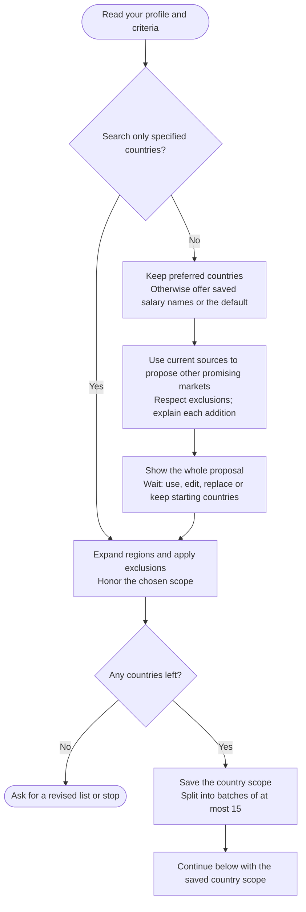

# Step 2: Country discovery



Discovery establishes the candidate countries and the evidence for each employment track. It identifies useful leads, constraints and gaps while preserving the difference between an explicit exclusion and information that has not been found.

## Flow

These are two stages of country discovery. The saved country scope at the end of the first diagram becomes the research batches at the start of the second. An empty scope needs revised countries or a stop before research.

### Country selection

### Research and timezone checks

## Choosing countries

An include preference keeps countries you want considered while leaving room for discoveries. For example, **include Germany** keeps Germany in an open search; **search only Germany** closes the scope to that country. Only materially unclear intent needs another question.

For an open search, the agent looks for other markets using current role-relevant demand and employer or pathway leads. Each addition comes with a short reason and dated source. This first pass proposes where to investigate; it does not certify a fit, require a complete job offer or claim to cover every country worldwide. Detailed suitability research still checks both tracks after you choose the list.

Without preferred countries, the agent can offer Salary Calculator's recorded research names, including countries whose salary data was skipped, or the shipped default list. Salary research need not be complete, and none of its conclusions transfer. That names-only offer and any proposed additions are handled in one country-choice question.

The complete proposal appears in chat before you answer. Default countries are printed by continent, with additions identified separately. You can use the proposal, change countries or keep only the starting list. A preferred or starting country is not silently removed for weak preliminary evidence, and an excluded country is not added back. Unclear region boundaries need clarification.

An explicit restricted list needs no further scope approval. Once chosen, the scope is saved and retained on resume, including older runs; a new discovery pass never silently expands it. An empty scope needs revised countries or stop. Without live discovery access, the agent explains the limit and offers supplied evidence or a disclosed starting-list-only search.

## What gets checked

Research looks at Remote and Sponsorship together for each country, but reaches separate conclusions.

| Track | Evidence that matters |
|---|---|
| Remote | Cross-border hiring, engagement and pay arrangements applicable to your actual working location. |
| Sponsorship | A named employer-sponsored route and relevant evidence that employers hire candidates through it. |

Domestic work-from-home rules do not establish cross-border Remote access. Likewise, a nomad or self-sponsored visa is not an employer-sponsored route. Sponsor registration alone does not prove an employer is willing to hire this candidate.

Research compares occupation-level demand, job hubs and personal fit alongside access. One vacancy cannot establish a deep market, and one employer's refusal cannot exclude the whole country. A shortage listing is distinct from both an immigration occupation list and employer willingness.

Findings use dated sources and retain their limits. Missing evidence is not a rejection. A salary-based Remote exclusion needs a valid comparable range entirely below a confirmed hard floor; context-only minima or incomplete comparisons cannot support that decision.

## Timezone preference

Timezone suitability affects Remote only and is skipped for no limit. Unless you choose another period, the check covers relevant hubs over the next twelve months, including daylight-saving changes.

A country with multiple employment hubs can have mixed results. A partial pass keeps the relevant hub or seasonal condition; incomplete coverage remains unverified. One favorable timezone observed today does not establish a full-year result.

## What happens next

The candidate file records scope, track findings, reasons, timezone conditions and evidence gaps. Chat gives brief counts rather than the full research body.

[Detailed research](../step3-research-prompt-generator.html) covers both positive leads and no-evidence findings. Only explicit supported exclusions skip that track. An unpublished salary or employment arrangement leaves a question to investigate rather than ending research.

## Explore the source

For implementation details, read [prompts/country-finder/step2-country-discovery.md](https://github.com/myowinthein/agent-compass/blob/main/prompts/country-finder/step2-country-discovery.md).

The shared [assessment framework](https://github.com/myowinthein/agent-compass/blob/main/skills/country-assessment-rules.md) defines the evidence factors and verification distinctions.
