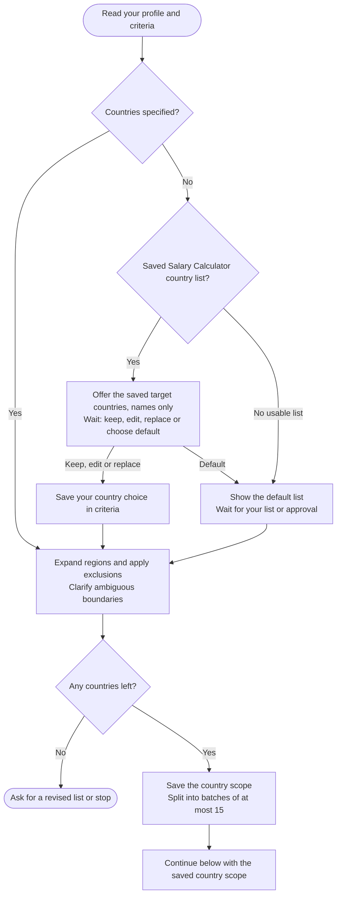
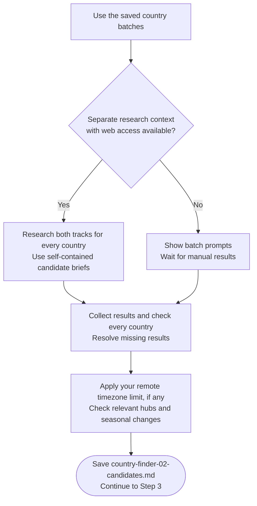

# Step 2: Country discovery



Discovery establishes the candidate countries and the evidence for each employment track. Its job is to decide what deserves deeper research while preserving the difference between an explicit exclusion and information that has not been found.

## Flow

## Choosing countries

An explicit include list comes first. Otherwise the agent can offer Salary Calculator's saved research country names, including countries whose salary data was skipped. You can keep, edit, replace or decline that list. Salary research need not be complete, and none of its conclusions transfer with the names.

If using the default is an option, the full country list is printed by continent before you answer. A question control is not the only place you should be able to inspect it. A clear list you supplied is used directly; uncertain region boundaries need clarification. Exclusions apply after regions have been expanded into countries.

Once chosen, the scope is saved and retained on resume. An empty result needs revised countries or a stop, not an invented research set.

## What gets checked

Research looks at Remote and Sponsorship together for each country, but reaches separate conclusions.

| Track | Evidence that matters |
|---|---|
| Remote | Cross-border hiring, engagement and pay arrangements applicable to your actual working location. |
| Sponsorship | A named employer-sponsored route and relevant evidence that employers hire candidates through it. |

Domestic work-from-home rules do not establish cross-border Remote access. Likewise, a nomad or self-sponsored visa is not an employer-sponsored route. Sponsor registration alone does not prove an employer is willing to hire this candidate.

Findings use dated sources and retain their limits. Missing evidence is not a rejection. A salary-based Remote exclusion needs a valid comparable range entirely below a confirmed hard floor; context-only minima or incomplete comparisons cannot support that decision.

## Timezone preference

Timezone suitability affects Remote only and is skipped for no limit. Unless you choose another period, the check covers relevant hubs over the next twelve months, including daylight-saving changes.

A country with multiple employment hubs can have mixed results. A partial pass keeps the relevant hub or seasonal condition; incomplete coverage remains unverified. One favorable timezone observed today does not establish a full-year result.

## What happens next

The candidate file records scope, track findings, reasons, timezone conditions and evidence gaps. Chat gives brief counts rather than the full research body.

[Detailed research](../step3-research-prompt-generator.html) follows the eligible yes tracks. Exclusions and no-evidence cases remain in the record for the final audit even when they receive no detailed research.

## Explore the source

For implementation details, read [prompts/country-finder/step2-country-discovery.md](https://github.com/myowinthein/agent-compass/blob/main/prompts/country-finder/step2-country-discovery.md).
