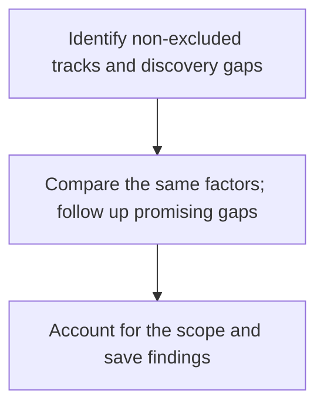

# Step 3: Research prompt generator



Compare each country's non-excluded tracks, including gaps left by discovery.

## Flow

## What each brief covers

Both briefs compare market demand, role match, international access and pay feasibility. Remote research applies to your working location; Sponsorship research adds the employer-sponsored route and candidate-specific conditions. Checked sources and unresolved questions remain visible.

Promising tracks with important gaps receive targeted follow-up before collection finishes. Unpublished or inaccessible evidence can remain unknown after substantive checks.

Each brief contains the confirmed role and relevant background directly. Researchers use current dated sources; unknown facts do not become assumed eligibility.

## Countries without an eligible track

Only an explicit supported [discovery exclusion](step2-country-discovery.html#what-gets-checked) skips a track. Both positive leads and no-evidence findings receive detailed research. With every track excluded, a scope-only record preserves the reasons without inventing research.

## What happens next

The assistant saves `country-finder-03-research.md`, checks expected countries and tracks, and shows a brief count before [Data validation](step4-data-validation.html).
