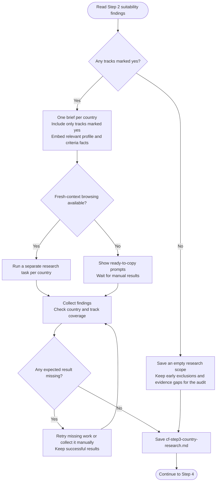

# Step 3: Research prompt generator

Builds a research brief for each eligible country and collects detailed findings for its suitable tracks.

## Flow

## What each brief covers

Remote research asks for realistic pay, hiring activity and payment arrangements that apply to your working location. It retains currency, pay period, gross/net basis and employee, EOR or contractor status.

Sponsorship research asks for the employer-sponsored route, applicable salary rule, employer willingness, processing time, quotas, dependent provisions and citizenship-specific considerations.

Every brief includes the relevant role, level, experience, skills and background directly. Researchers use current web sources and return dated findings. Unknown age or work status stays unknown rather than becoming an assumed visa category.

## Countries without an eligible track

Only a Step 2 "yes" receives detailed research. An explicit rejection and "no evidence found" are kept distinct for the final audit.

If no tracks qualify, this step saves a scope-only record instead of inventing research. The remaining steps still account for the countries and their exclusions or evidence gaps.

## What happens next

The assistant saves findings to `cf-step3-country-research.md` and shows a brief researched-country count. It checks that expected countries and tracks are covered before continuing.

[Step 4: Data validation](step4-data-validation.html) checks and stores the results.
