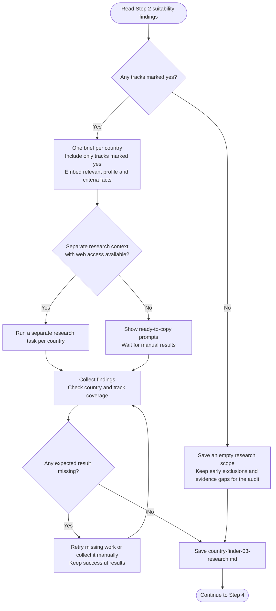

# Step 3: Research prompt generator

Collect detailed research for each country's eligible tracks.

## Flow

## What each brief covers

Remote briefs cover pay, hiring and payment arrangements for your working location. Sponsorship briefs cover the employer-sponsored route, salary rules, employer willingness, processing, quotas and relevant candidate restrictions.

Each brief contains the confirmed role and relevant background directly. Researchers use current dated sources; unknown facts do not become assumed eligibility.

## Countries without an eligible track

Only Step 2 "yes" tracks receive detailed research. Explicit rejections and missing evidence remain distinct. With none eligible, a scope-only record lets later steps account for exclusions and gaps without inventing research.

## What happens next

The assistant saves `country-finder-03-research.md`, checks expected countries and tracks, and shows a brief count before [Data validation](step4-data-validation.html).
