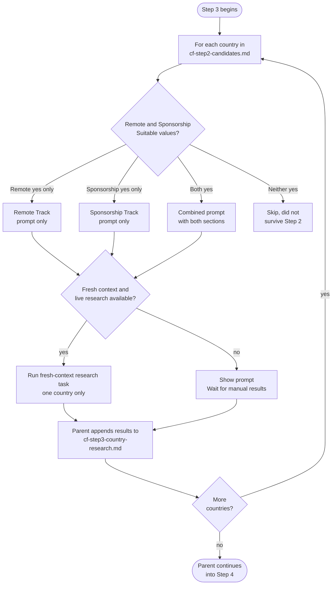

# Step 3: Research prompt generator

Generates one ready-to-copy research prompt per candidate country, then runs each as a fresh-context research sub-agent. The assistant does not answer the research questions itself in this step. Every prompt instructs the researcher to prefer sources in order: official government sources, direct employer pages, official sponsor/accredited-employer registers (capability only, not intent), specialist job boards/recruiters/salary surveys, then aggregators (which need direct verification), and to report which tier each source falls into.

## Flow

## What it reads

- `cf-step2-candidates.md` from Step 2
- `profile.md` and `situational-profile.md`: target role/skillset and citizenship/immigration friction are embedded as literal text into each generated prompt, so the researcher can work from its own brief without reading profile files or relying on the parent's conversation

Sponsorship briefs also embed the supplied age/date reference, residence and work-rights facts needed to check the applicable official threshold category. Unknown facts remain unknown rather than selecting an age-dependent threshold by assumption.

Both tracks receive their relevant settled level, dated experience, location, languages and work status. Remote pay keeps its currency, period, gross/net basis and engagement type, and must apply to the candidate's working location. The existing threshold field retains the shared five visa states and the applicable category, period and official evidence instead of an ambiguous "none known".

## Prompt structure per country

Each prompt covers only the track(s) Step 2 marked "yes" for that country:

| Step 2 Suitable values | Prompt contains |
|---|---|
| Remote yes, Sponsorship not yes | Remote Track section only |
| Sponsorship yes, Remote not yes | Sponsorship Track section only |
| Both yes | Both sections in one combined prompt |
| Neither yes | Skipped: no prompt generated |

**Remote Track section asks for:**
- Confirmed realistic remote salary range for your role and seniority, in local currency
- Evidence of remote hiring volume (job postings, hiring reports, company policies)
- Typical payment structure (local currency vs USD, contractor vs employee)
- Sources with dates

**Sponsorship Track section asks for** a pathway where a local employer is the sponsor, not a digital-nomad, remote-worker, long-stay, or self-qualifying visa, even if prominent in search results, since those don't involve a local employer sponsoring you. It requests:
- Full name of the specific employer-sponsored work-visa pathway and its official source
- Minimum salary threshold required by that visa
- Realistic employer willingness to sponsor your specific role
- Realistic visa processing time
- Any quota, cap, or annual limit
- Family or dependent sponsorship provisions
- Citizenship-specific complications based on your situational profile
- Sources with URLs and dates

## Sub-agents

Each country's prompt is run as a separate fresh-context research task. Each agent:

- Receives a self-contained brief for its assigned country
- Is instructed not to read workspace files or other researchers' results
- Returns findings only; the parent appends them to `cf-step3-country-research.md`

Fresh conversation context does not guarantee filesystem isolation. Before delegation, the parent checks that fresh conversation context and live web research are available. If either capability is unavailable or cannot be established, it shows all prompts and waits for you to bring back results manually.

## Output

Eligible countries are saved before collection. With zero eligible tracks, a scope-only record leads to an empty stored-data record and a final audit of the known exclusions and gaps. Discovery with no evidence is distinguished from detailed research that was never run; an all-Pending result is valid and does not automatically trigger more research.

- `cf-step3-country-research.md`: per-country research results, appended as each agent completes. The assistant does not reproduce these findings in chat; only a brief summary (countries researched) and confirmation that the file is saved for Step 4 to validate and store.

## Stop condition

The parent waits for manual results if fresh conversation context or live web research is unavailable or cannot be established. In the normal, automated case, once all results are saved to `cf-step3-country-research.md`, the parent continues automatically into Step 4 within the same response, without waiting for a new message.
