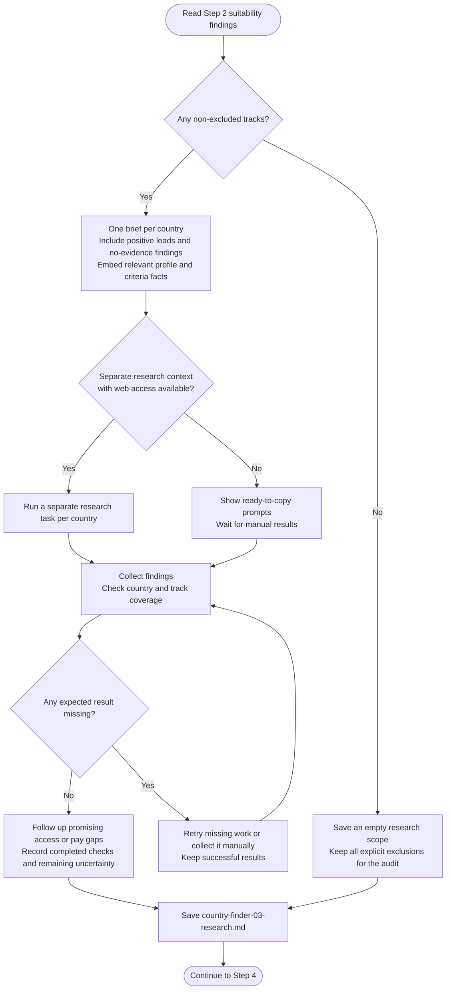

# Step 3: Research prompt generator



This step gives each eligible country track a focused research brief. The brief carries the candidate facts it needs, and the collection process accounts for missing results without blending unrelated countries' findings.

## Flow

## What each brief covers

Both tracks compare market demand, personal role match, international access and pay feasibility. Demand covers relevant occupations and job hubs, recurring employers and trends, rather than a single exact-title vacancy. Remote evidence must apply to your working location; Sponsorship adds the named employer route, salary rules, processing and candidate restrictions.

An official shortage is a useful signal, not proof of personal access. The [ILO classification](https://ilostat.ilo.org/methods/concepts-and-definitions/classification-occupation/) distinguishes occupations by their work and skills; the [OECD shortage methodology](https://www.oecd.org/en/publications/mapping-skill-shortages-in-oecd-countries_735f9485-en/full-report/component-5.html) combines indicators and explains why vacancies alone are incomplete evidence. Country Finder applies these principles without turning broad statistics into offer probabilities.

Each task receives the confirmed role and relevant background directly. Researchers should not need to infer your citizenship, work rights or seniority from a pointer to another private file. Current dated sources support the findings, with missing or conflicting information called out.

Research is collected in separate contexts when the host has the required tools. If suitable research access is unavailable, the workflow supplies prompts and waits for manual results. A model's general recollection is not silently substituted for completed research.

## Countries without an eligible track

Both positive leads and no-evidence findings from [discovery](../step2-country-discovery.html#what-gets-checked) receive deeper investigation. Only an explicit supported exclusion skips a track. A country can therefore have research for one track or both; neither applies only when both are excluded.

Neither does not mean the country disappears. Explicit rejection and missing evidence retain their separate reasons. When every track is explicitly excluded, a scope-only record allows later steps to account for those exclusions without manufacturing research or scores.

If new material contradicts an earlier exclusion, the parent workflow returns for a repair decision. A researcher does not silently widen the selected country set or overwrite the original eligibility choice.

## Following up gaps

A promising market with unclear pay, sponsorship or location terms receives a targeted follow-up using another relevant source or employer policy. The result retains the original findings and any new dated evidence, including contradictions. No employer is contacted automatically.

For example, a recurring Laravel market and a close worldwide vacancy can establish useful potential while leaving the actual engagement and pay unresolved. The follow-up checks those conditions; it does not require inventing a complete offer before the country can be assessed.

Research coverage records checks performed, opened sources, access failures and remaining questions. An unavailable fact after substantive research differs from a task that never ran. The latter requires recovery; the former can remain unresolved with a specific next action.

## What happens next

The agent accounts for expected countries and tracks, preserves successful research and records the missing remainder. A failed task does not justify losing the others' results.

The research file is saved before [Data validation](../step4-data-validation.html). Chat shows a short count; the richer evidence remains available in the saved material. The next step checks whether blocks are structurally usable, not whether every claim has already passed an independent factual audit.

## Explore the source

For implementation details, read [prompts/country-finder/step3-research-prompt-generator.md](https://github.com/myowinthein/agent-compass/blob/main/prompts/country-finder/step3-research-prompt-generator.md).

The shared [assessment framework](https://github.com/myowinthein/agent-compass/blob/main/skills/country-assessment-rules.md) defines the evidence factors and verification distinctions.
