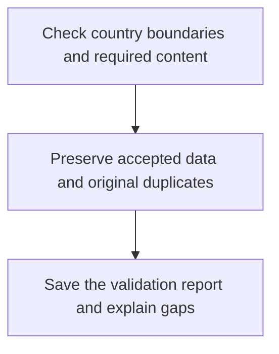

# Step 4: Data validation



Store structurally complete research unchanged. This checks required content, not the truth of claims.

## Flow

## What is accepted

Each country needs the fields for its [non-excluded tracks](step2-country-discovery.html#what-gets-checked). Malformed, incomplete, duplicate and unlisted data is skipped with reasons; duplicates preserve stored originals. Older labels are accepted after review when their meaning is clear.

A reported unknown can be structurally complete when it explains the checks and limitations. Missing comparison fields in new research are incomplete; older records are reviewed for equivalent meaning.

Generated blocks use top-level `Country:` delimiters. Ambiguous boundaries need clarification.

## What you see

One report accounts for stored countries, rejected blocks and missing results. Retained duplicates are not missing countries. Helpers save accepted research exactly as supplied. If helpers cannot run, manual processing needs your explicit approval.

## What happens next

- `country-finder-04-validated-data.md`: accepted data.
- `country-finder-03-research.md`: original findings and separate Validation report.

With every track explicitly excluded, empty research can proceed to an audit of those exclusions. Failed saves leave progress pending. After successful saving, continue to [Scoring](step5-scoring.html).
