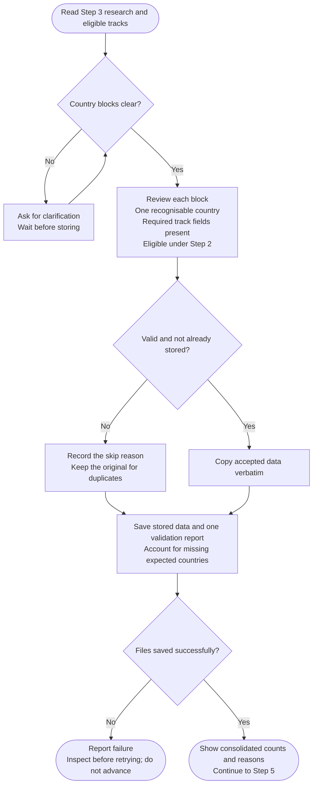

# Step 4: Data validation

Checks the research structure and stores accepted country data without changing its wording or values. This step does not verify claims, score countries or make recommendations.

## Flow

## What is accepted

Each country needs the required sections and fields for every track Step 2 marked suitable. Data for a country with no eligible track is not stored automatically.

Malformed blocks, missing fields and duplicates are skipped with their reasons. A duplicate never replaces the first stored original. Older field wording can be accepted after review when its meaning is clear.

Generated datasets start with a top-level `Country:` field. Blank lines alone do not separate countries. If boundaries are genuinely unclear, the assistant asks rather than guesses.

## What you see

One consolidated report lists the stored count, skipped blocks and missing expected countries. A skipped duplicate is not a missing country when its original was retained.

The shared helper preserves accepted research byte-for-byte. It checks structure and coverage, not whether the research is true. If execution is unavailable, manual processing requires your approval.

## What happens next

- `country-finder-04-validated-data.md` holds accepted data.
- `country-finder-03-research.md` keeps the original research and a separate Validation report.

With no eligible tracks, an empty stored record and report still allow the audit to explain known exclusions and gaps.

After successful saving, the workflow continues to [Step 5: Scoring](step5-scoring.html).
