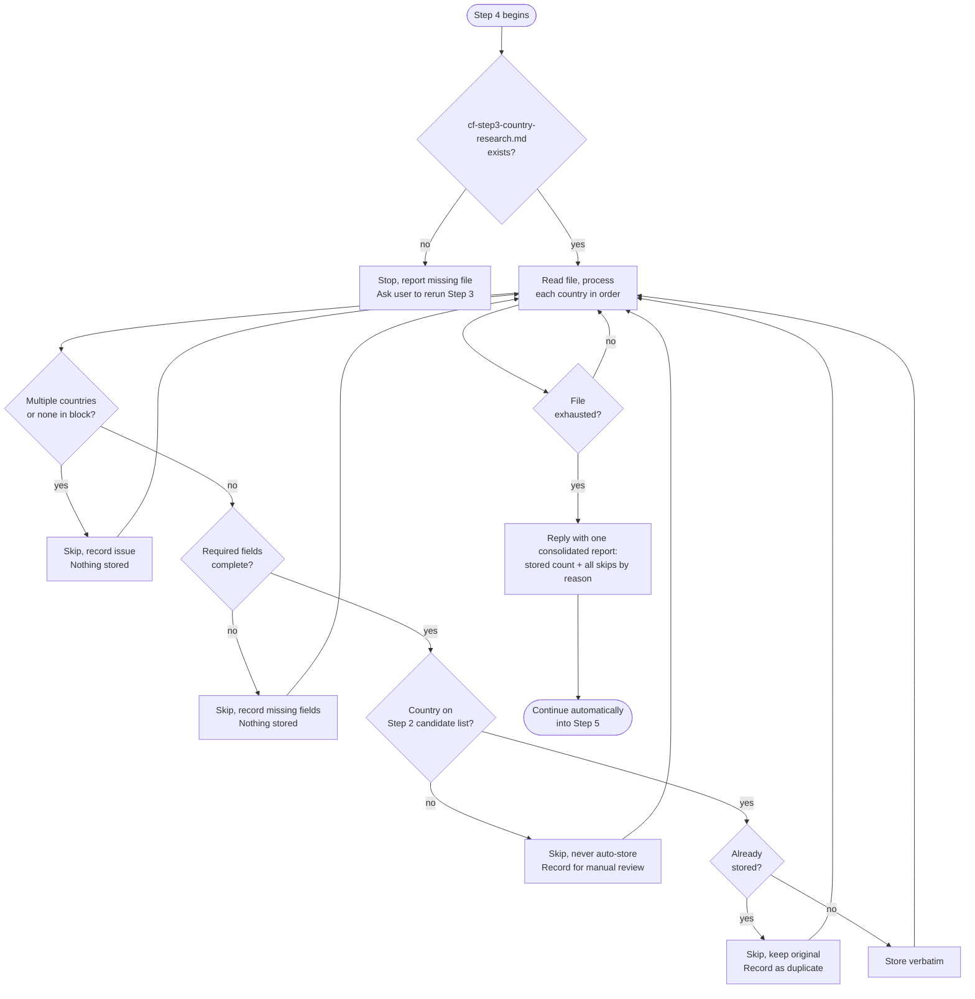

# Step 4: Data validation

The parent uses the shared helper to scan country boundaries and coverage, reviews ambiguous fields, then copies accepted raw blocks without retyping. The existing research file receives the validation report. Hash checks prevent overwriting changed input; partial writes report exactly which files were saved. A checked retry preserves originals, and state does not advance on failure. No new database or profile format is introduced.

A strict silent-storage mode. The assistant reads `cf-step3-country-research.md` written by Step 3 and processes each country's data autonomously, no pasting required. If the file is missing, the assistant stops and reports it rather than waiting for manual input.

## Flow

## What it reads

- `cf-step3-country-research.md`: written by the parent from Step 3's subagent results
- `cf-step2-candidates.md`: used to validate that each country was marked suitable for at least one track

## Rules

Identifiable malformed items are skipped and recorded without pausing between countries. Genuinely ambiguous boundaries require parent-side clarification rather than guessed separators.

Generated blocks start at a top-level `Country:` field and end at the next such field, Validation report, or end of file. Blank lines alone do not split countries. Two top-level Country fields mean two datasets; an explicitly fenced dataset containing two countries is malformed. Unambiguous legacy boundaries are accepted without rewriting the supplied country text.

| Situation | Assistant's response |
|---|---|
| File not found | Stops, reports missing file, asks user to ensure Step 3 completed |
| Block contains multiple countries | Skips it and records the issue, nothing stored |
| Block contains no recognizable country | Skips it and records the issue, nothing stored |
| Required field or section missing | Skips it and records what's missing, nothing stored |
| Country not marked suitable for any track in Step 2 | Never stored automatically, skipped and recorded for manual review |
| Country already stored | Skips it, keeps original, records it as a duplicate |
| Valid, complete data for one country | Stored silently |

The assistant preserves all values, wording, and formatting exactly as provided. It does not correct, improve, or reinterpret the data.

## What the assistant does not do in this step

- No analysis, scoring, or ranking
- No research summaries or analytical tables
- No opinions or recommendations
- No additional actions unless explicitly instructed

## Stop condition

The stored datasets remain in `cf-step4-country-data.md`. The consolidated report is also persisted at the end of `cf-step3-country-research.md` under Validation report, outside its unchanged country blocks, including every rejection reason and expected-but-missing country. A rejected duplicate with a retained original is not a missing-country failure. Later audits use this record to distinguish rejected research from never-supplied research.

After saving the datasets and validation report, the parent presents the consolidated counts and reasons and enters Step 5, including its specialist-routing question. Only genuinely ambiguous input boundaries require clarification during ingestion.
