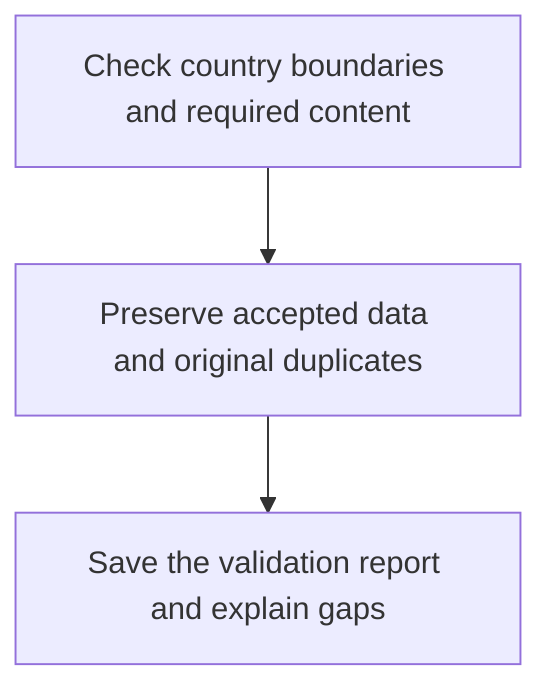

# Step 4: Data validation



Store structurally complete research unchanged. This checks required content, not the truth of claims.

## Flow

## What is accepted

Each country needs the fields for its [Step 2 eligible tracks](step2-country-discovery.html#what-gets-checked). Malformed, incomplete, duplicate and unlisted data is skipped with reasons; duplicates preserve stored originals. Older labels are accepted after review when their meaning is clear.

Generated blocks use top-level `Country:` delimiters. Ambiguous boundaries need clarification.

## What you see

One report accounts for stored countries, rejected blocks and missing results. Retained duplicates are not missing countries. Helpers preserve accepted bytes; manual processing needs explicit approval when execution is unavailable.

## What happens next

- `country-finder-04-validated-data.md`: accepted data.
- `country-finder-03-research.md`: original findings and separate Validation report.

Empty eligible scope can still proceed to an audit of exclusions/gaps. Failed saves leave progress pending. After successful saving, continue to [Scoring](step5-scoring.html).
