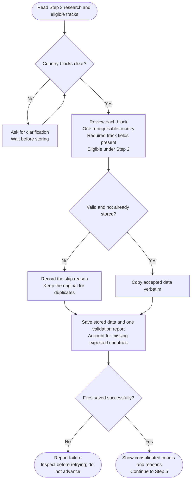

# Step 4: Data validation



Validation makes the research usable without rewriting it. It checks country boundaries and required track content, preserves accepted evidence as supplied and gives a clear account of what was stored or skipped.

## Flow

## What is accepted

A country block needs the content required for its discovery-eligible tracks. Missing Remote material is relevant when Remote was eligible; it does not become a reason to invent that track for an explicitly excluded country.

Generated research uses top-level `Country:` delimiters. Clear older labels can be recognized when their meaning is unambiguous. If boundaries are unclear, the agent asks rather than guessing which country's evidence a paragraph belongs to.

Malformed, incomplete, duplicate and unlisted blocks are skipped with reasons. A duplicate preserves the stored original; it is not automatically treated as a missing country. Scope membership and accepted track coverage are accounted for separately.

## What you see

The validation report distinguishes accepted data, rejected input and expected results that were never supplied. Accepted bytes remain unchanged. Corrections or validation commentary belong outside the original research blocks.

This is structural validation. A complete field containing an outdated immigration claim can pass this step and still fail the later evidence audit. Successful saving is also distinct from factual correctness.

Helpers handle preservation and ingestion when execution is available. If it is not, manual processing needs explicit approval of the actual fallback, including its limits. Failed saves leave progress pending rather than advancing to scoring as though the data had been stored.

For example, retaining one valid original and rejecting its later duplicate should produce one stored country, not a new missing-country warning. Rejecting the only incomplete result for an eligible country should retain a visible evidence gap.

## What happens next

Accepted content is stored in the validated-data file, while the original research and separate validation report remain available. Empty eligible research can still proceed to an audit of exclusions and gaps when the candidate scope is nonempty.

After a successful save, [Scoring](../step5-scoring.html) uses only supported data for each track. Missing information is not filled with an assumed Weak fit.

## Explore the source

For implementation details, read [prompts/country-finder/step4-data-validation.md](https://github.com/myowinthein/agent-compass/blob/main/prompts/country-finder/step4-data-validation.md).
