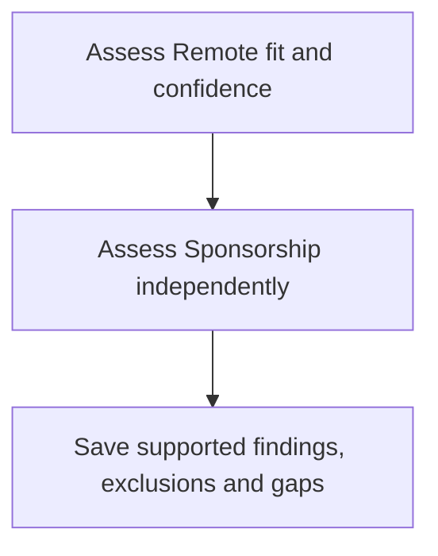

# Step 5: Scoring



Assess Remote and Sponsorship separately using categorical fits and confidence, without numerical scores.

## Flow

## Fit and confidence

Supported tracks receive Strong, Moderate or Weak fit and High, Medium or Low confidence. Vague, old or unsourced evidence lowers confidence. No usable evidence means `not scored (no data)`, not an invented Weak fit.

Market demand and personal fit remain separate from access and pay verification. Supported potential can receive a conditional fit even when a material offer condition is unknown; the final ranking uses Investigate next for those checks. Earlier exclusions retain their reasons and affect only their own track.

## Salary checks

Remote exclusion needs a comparable pay range entirely below your hard floor. Context-only minima, missing conversion or a straddling range do not prove failure.

For relocation, a comparable market range entirely below your hard floor supports Weak pay feasibility rather than a legal visa rejection. A single low-paying advert does not establish a country-wide shortfall.

Sponsorship can use an optional compatible Salary Calculator [visa-pay comparison](../salary-calculator/step4-table-calculation.html#visa-salary-rule-comparison). Completed final figures take precedence over pre-audit values. This does not independently exclude a country or establish visa eligibility; local-employee targets do not prove cross-border Remote pay.

## What happens next

The assistant saves `country-finder-05-assessment.md` and shows brief counts. The step runs on your current model and effort; [Final ranking](step6-final-ranking.html) always follows.
