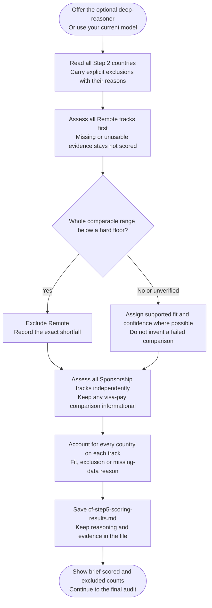

# Step 5: Scoring

Assesses Remote and Sponsorship fit separately using the stored research. Despite the step's name, fits are categories, not numerical scores.

## Flow

## Fit and confidence

Each supported assessment has a Strong, Moderate or Weak fit, a High, Medium or Low confidence level and brief evidence-based reasoning.

Vague, old or unsourced claims reduce confidence. If no applicable evidence remains usable, the track is recorded as `not scored (no data)`, not assigned an invented Weak fit.

An explicit Step 2 rejection remains Excluded with its original reason. A rejection on one track never removes the other.

## Salary checks

For Remote, only a comparable pay range entirely below your hard floor can trigger exclusion. A context-only minimum, missing exchange rate or range crossing the floor cannot establish failure.

For Sponsorship, a compatible Salary Calculator result can provide an informational visa-pay comparison. It is optional and does not independently exclude a country or prove visa eligibility. A completed final takes precedence over its pre-audit figures; missing or incompatible data stays unverified.

Salary Calculator's local-employee benchmarks are not evidence of cross-border remote offers.

## What happens next

Full assessments are saved to `cf-step5-scoring-results.md`. Chat shows only brief counts.

You may choose a [specialist agent]({{ '/docs/specialist-agents.html' | relative_url }}) or keep your current model. Either way, [Step 6: Final Ranking](step6-final-ranking.html) runs next.
