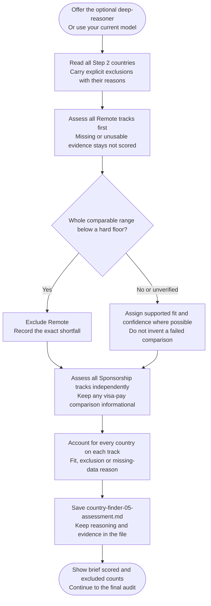

# Step 5: Scoring

Assess Remote and Sponsorship separately using categorical fits and confidence, without numerical scores.

## Flow

## Fit and confidence

Supported tracks receive Strong, Moderate or Weak fit and High, Medium or Low confidence. Vague, old or unsourced evidence lowers confidence. No usable evidence means `not scored (no data)`, not an invented Weak fit.

Earlier exclusions retain their reasons and affect only their own track.

## Salary checks

Remote exclusion needs a comparable pay range entirely below your hard floor. Context-only minima, missing conversion or a straddling range do not prove failure.

Sponsorship can use an optional compatible Salary Calculator [visa-pay comparison](../salary-calculator/step4-table-calculation.html#visa-salary-rule-comparison). Completed final figures take precedence over pre-audit values. This does not independently exclude a country or establish visa eligibility; local-employee targets do not prove cross-border Remote pay.

## What happens next

The assistant saves `country-finder-05-assessment.md` and shows brief counts. An optional [specialist]({{ '/docs/specialist-agents.html' | relative_url }}) can run the step; [Final ranking](step6-final-ranking.html) always follows.
