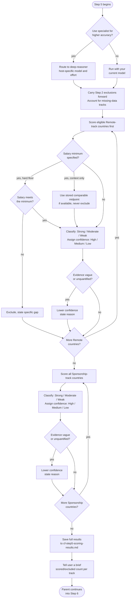

# Step 5: Scoring

Assesses every stored country against your criteria, keeping Remote and Sponsorship tracks completely separate. Fits and confidence are categorical, not numerical scores, percentages, or a combined priority formula. Step 6 assigns application priorities after its audit; legacy numbers are not converted into new fits without stored evidence. Before running, the assistant asks whether to use the **deep-reasoner** subagent (host-specific model and effort) for higher reasoning accuracy. If you decline, the step runs with your current model.

For model choices, effort settings and approval, see [Specialist agents]({{ '/docs/specialist-agents.html' | relative_url }}).

## Flow



## What it reads

- `cf-step4-country-data.md`: all country data from Step 4
- `cf-step2-candidates.md`: the full candidate universe and recorded per-track exclusions, including timezone rejections
- `cf-step1-criteria.md`: timezone limit (informational, already applied in Step 2)
- `situational-profile.md`: salary minimum (optional, skipped if not specified) and citizenship-specific friction
- `sc-step5b-final-verification.md`: completed Salary Calculator audit, when available, for authoritative raw targets; `sc-step4-salary-table.md` is the pre-audit source for unchanged segments or when no final exists

## Batching rule

All Remote-track countries are scored first, all the way through, before Sponsorship scoring begins for any country. Tracks are never interleaved.

## Remote track scoring

For each country with Remote data stored:

1. Apply a stated hard floor only to comparable Remote pay, excluding only when the entire range falls short. Context-only minima never exclude: use a stored comparable midpoint if available, otherwise note the missing benchmark. Salary Calculator's local-employee targets are not remote-offer evidence. If no minimum was specified, skip the check.
2. If it passes: classify Remote fit as **Strong**, **Moderate**, or **Weak**.
3. Assign confidence: **High**, **Medium**, or **Low**.
4. Give brief reasoning referencing actual stored evidence, not assumption.

## Sponsorship track scoring

For each country with Sponsorship data stored:

1. If a visa minimum salary threshold was reported, prefer a completed Salary Calculator final audit. File existence alone does not establish completion. Use final raw targets for revised segments and Step 4 raw targets only for explicitly unchanged segments with matching inputs, or when no final exists. Missing final raw values after possible recalibration must not silently resurrect older figures. Ambiguous completion or comparison evidence stays unverified; rounded cells never decide clearance. This remains an informational note, not a country exclusion or overall eligibility finding.
2. Classify Sponsorship fit as **Strong**, **Moderate**, or **Weak**.
3. Assign confidence: **High**, **Medium**, or **Low**.
4. Give brief reasoning referencing actual stored evidence, including any citizenship-specific friction from the situational profile.

Optional Salary Calculator references use the shared completion/provenance rule and must match the candidate, role, benchmark scope and assessed visa route/category. Read approved final visa updates as well as salary recalibration; a newer date alone does not prove applicability. Monthly legal-pay comparisons require the official payment basis, not an automatic annual/12 assumption. A different path's Not applicable state does not negate the sponsorship route, and a Blocked state applies only to its assessed route. Missing or incompatible references remain informational and unverified.

## Evidence quality rule

If the stored research uses vague or unquantified language ("sometimes," "generally friendly," "fairly common"), confidence is lowered and the reason is stated. Vague claims are never treated as strong evidence.

## Exclusion transparency rule

Every excluded country/track is listed with a specific, evidence-based reason. Explicit Step 2 rejections are carried forward before scoring, with the original reason and any hard-rule detail; a timezone rejection remains an exclusion, not missing data. The other track is assessed independently. Excluded counts include these earlier rejections, which are not counted as scored.

Missing research or "no evidence found" without an explicit rejection is recorded as **not scored (no data)**, not Excluded, and counted as neither scored nor excluded. Step 6 audits these absences to distinguish evidence limitations from process gaps. "General reputation" is never an acceptable exclusion reason.

The saved Validation report in Step 3's research file explains ingestion failures without treating them as evidence-based country rejections. Salary-floor decisions use the shared currency/period/pay-basis policy: sourced FX is recorded when needed, while missing rates or a range straddling the floor cannot prove a failure.

## File format

This structure is written to `cf-step5-scoring-results.md`; it is not what the assistant shows in chat (see Output below):

```
Remote Track Results
- [Scored countries: fit, confidence, brief reasoning]
- [Excluded countries: specific reason]
- [Unresearched countries/tracks: not scored (no data), with what is missing]

Sponsorship Track Results
- [Scored countries: fit, confidence, brief reasoning]
- [Excluded countries: specific reason]
- [Unresearched countries/tracks: not scored (no data), with what is missing]

Summary
- Remote: [N] scored, [N] excluded
- Sponsorship: [N] scored, [N] excluded
```

## Output

Full results are saved to `cf-step5-scoring-results.md` in the workspace. Step 6 reads this file directly and always runs next to produce the curated, human-facing result, so the assistant does not reproduce this detailed breakdown in chat. Instead, it tells you in a few lines how many countries were scored and excluded on each track, and confirms the file is saved.

## Stop condition

There is no interactive checkpoint within scoring. A specialist returns the saved scoring results to the parent. The parent checks the output and enters Step 6, including its specialist-routing question. Final Ranking always runs; choosing a specialist remains optional.
