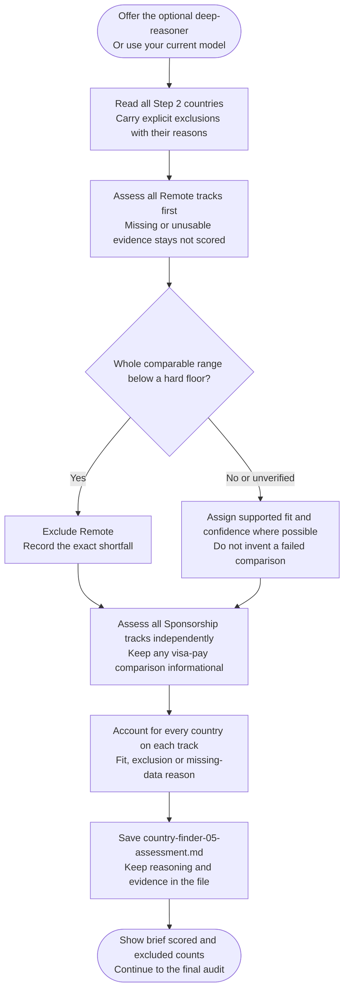

# Step 5: Scoring



Scoring turns usable research into a fit assessment for each track. It keeps opportunity fit separate from confidence in the evidence, so a promising but poorly supported country is not presented as a certain recommendation.

## Flow

## Fit and confidence

Supported Remote and Sponsorship tracks receive **Strong**, **Moderate** or **Weak** fit, with **High**, **Medium** or **Low** confidence. There are no numerical country scores.

The assessment separately explains market demand, your role match, international access, pay feasibility, practical constraints and research coverage. It preserves useful supported potential when pay or access still needs verification. A single relevant vacancy can support a conditional Moderate assessment; Strong needs converging market and employer evidence.

For example, recurring relevant hiring with uncertain sponsorship can remain Moderate fit while access is Unverified. The final result then recommends Investigate next rather than presenting it as ready for concentrated applications. A missing source that invalidates all applicable role/demand evidence still leaves the track unscored.

The assessment explains how the opportunity matches your role, working situation and constraints. Evidence that is vague, old or poorly sourced reduces confidence. When there is no usable evidence, the result is `not scored (no data)` rather than an invented Weak fit.

The tracks remain independent. A known exclusion retains its reason and affects only its own track. Strong Remote evidence does not establish Sponsorship, and an absent sponsorship route does not automatically reject Remote.

## Salary checks

Remote pay must be comparable to the candidate's confirmed hard floor before it can support an exclusion. Currency, gross/net basis and pay period matter. A range entirely below that floor can establish failure; a straddling range, context-only preference or unavailable conversion cannot.

Relocation pay is assessed separately against a supplied personal hard floor. An entire comparable role/level range below it supports Weak feasibility, not a legal sponsorship block. A low-paying vacancy, visa minimum or salary-tier point estimate alone cannot establish that the relevant market range fails. Missing or straddling evidence remains unverified.

An optional compatible Salary Calculator result can inform a Sponsorship visa-pay comparison. Audited final figures take precedence over pre-audit estimates. This comparison does not independently exclude a country or establish visa eligibility.

Salary Calculator estimates local-employee targets. Those targets cannot be reused as evidence of cross-border Remote pay. For example, a strong local package does not show what an employer would pay someone remaining in another country.

## What happens next

The saved assessment retains the evidence, fit, confidence, exclusions and gaps for each track. Chat shows brief counts rather than replacing the report with an unexplained ranking.

An optional specialist can perform this step, but declining leaves the assessment on your current model. [Final ranking](../step6-final-ranking.html) always follows for the nonempty candidate scope and audits the assumptions before assigning application priorities.

A later contradiction of an early exclusion returns for a repair decision. The scoring step does not silently rewrite the source research or change the original country scope.

## Explore the source

For implementation details, read [prompts/country-finder/step5-scoring.md](https://github.com/myowinthein/agent-compass/blob/main/prompts/country-finder/step5-scoring.md).

The shared [assessment framework](https://github.com/myowinthein/agent-compass/blob/main/skills/country-assessment-rules.md) defines the evidence factors and verification distinctions.
