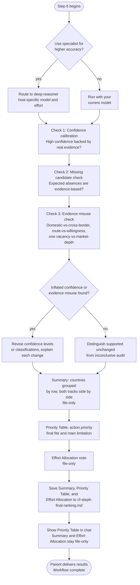

# Step 6: Final Ranking

A focused audit of the Step 5 scoring output, followed by a prioritized Country Finder result: the Priority Table. Always runs; unlike the rest of the pipeline this is the only step with no skip option, since it's what produces the final result. The three checks, the Summary, and the Effort Allocation note are all file-only; the Priority Table is the one thing this step shows directly in chat. The assistant asks whether to use the **deep-reasoner** subagent (host-specific model and effort) for higher reasoning accuracy on the audit itself. If you decline, the step runs with your current model.

For model choices, effort settings and approval, see [Specialist agents]({{ '/docs/specialist-agents.html' | relative_url }}).

## Flow

## Purpose

Challenges the two aspects of Step 5 scoring that Step 5 cannot self-audit: whether high-confidence labels are genuinely earned, and whether any expected countries are absent due to process gaps rather than evidence-based elimination.

## What it reads

- `cf-step5-scoring-results.md`: pre-audit scoring output, left unchanged as the historical record; final ratings incorporate any supported revisions from this step
- `cf-step2-candidates.md`: the full candidate universe, used to detect countries that were candidates but never reached Step 4
- `cf-step4-country-data.md`, `cf-step1-criteria.md`, `situational-profile.md`, and `profile.md`: the underlying evidence, criteria, situational profile, and candidate profile (the last used for the Priority Table's medal assignment)

All inputs come from workspace files, so the audit is safe to route to the deep-reasoner specialist.

## The three checks

**1. Confidence calibration check**

For every country marked High confidence: verifies that the underlying evidence is genuinely specific, sourced, and dated, not just confidently worded. Flags any confidence level that seems inflated relative to the actual evidence quality and explains why.

**2. Missing candidate check**

Compares the Step 2 candidate list against the countries that reached Steps 4 and 5 (and also considers any commonly expected country that is absent). For each missing country, states whether the absence was a genuine evidence-based elimination (citing the reason from earlier steps) or a process gap, such as being a Step 2 candidate that was never researched or never reached Step 4.

This reconciliation is per track: an explicit Step 2 rejection remains Excluded with its recorded reason, even when an older Step 5 output omitted it. The absence of follow-up research after that rejection is expected, not a process gap. A rejection on one track does not remove the other track.

**3. Evidence misuse check**

Checks each scored country's stored reasoning for three specific misreadings: domestic-only remote-work evidence counted as proof of cross-border remote hiring; a legal visa route or sponsor-eligibility register treated as proof of actual employer willingness rather than mere possibility; and a single job vacancy treated as proof of deep, ongoing market demand. Flags any country whose classification or confidence rests on one of these misreadings and explains what the evidence actually supports.

## Recalibration

If the confidence calibration check found inflated confidence levels, or the evidence misuse check found a misreading that changes a country's real fit:
- The affected country's confidence level is revised
- If inflated confidence or evidence misuse was masking a genuinely weaker fit, the classification is revised too
- Each change is explained with the evidence that caused it

When no revision is supported, the audit distinguishes supported unchanged results from an inconclusive finding. If the only applicable evidence is invalidated, the track becomes not scored/Unknown with its reason, not an invented Weak fit. Original research and Step 5 remain unchanged.

## Summary

After the recalibration verdict, the assistant writes a Summary into the file (not shown in chat; the Priority Table below is the only thing from this step shown in chat) that reorganizes Step 5's final scores (including any revisions from this step) by country rather than by track, each country showing its Remote and Sponsorship fit side by side.

| Country | Remote fit | Sponsorship fit |
|---|---|---|
| Example A | Strong | Moderate |
| Example B | Excluded | Strong |
| Example C | not scored (no data) | Weak |

Rules for the table:

- **Excluded**: the country was explicitly eliminated on that track in Step 2 or Step 5. The audit preserves the recorded reason and hard-rule detail.
- **not scored (no data)**: required research was not ingested or proved unusable, without a supported explicit exclusion. The audit records the actual evidence gap. This is distinct from Excluded and a supported Weak fit.
- If Step 6 revised a country's confidence level or classification, the explanation stays in the saved Recalibration audit, outside the canonical Summary sections.

The Summary includes countries with ingested research or a recorded exclusion on at least one track. Other candidates are accounted for in separate audit notes: **Flagged but not researched** is reserved for research genuinely never supplied, not research rejected during ingestion. Intentionally excluded countries are not put in that process-gap list.

The audit reads Step 3's persisted Validation report when available. Rejected data is noted as **Researched but not ingested**, with its exact reason, rather than never researched. Legacy cases without enough evidence are labeled **Ingestion outcome unknown**. These notes do not add Summary fit categories. Their missing-data tracks appear as Unknown in the Priority Table; a duplicate whose original survived does not become a missing country.

Reasons identify the stage, such as discovery finding no evidence before detailed research. Changed inputs or evidence contradicting an early exclusion return to the parent for a repair choice. The audit does not silently undo an earlier reason or restart completed results.

The section closes with counts:
- Remote: [N] scored, [N] excluded, [N] not scored (no data)
- Sponsorship: [N] scored, [N] excluded, [N] not scored (no data)

Each Step 2 candidate is counted once per track, including missing-data cases in the separate list. Early rejections count as excluded, not missing data. Any additional expected-but-absent countries are discussed separately from these totals.

The Summary itself contains no ranking, recommendations, or interpretation beyond the classifications above; ranking is reserved for the Priority Table below.

For new runs, the shared renderer produces the Summary, coverage counts and Priority Table from the same post-audit decisions, and checks the actual saved sections. It rejects contradictory priority/fit combinations but never chooses a fit or priority. The assistant reads legacy Summaries directly; completed outputs are not migrated.

## Priority Table

The five-column table is saved after the Summary and shown directly in chat. Its final fits come from the post-audit Summary, not superseded Step 5 ratings.

**Priority describes what to do**, rather than repeating which track is usable:

- **🥇 Focus**: concentrate application effort on the best supported opportunities.
- **🥈 Selective**: apply to well-matched openings where the narrower market or limitation is manageable.
- **🥉 Monitor**: use alerts and pursue occasional exceptional matches.
- **🎗️ Deprioritize**: both tracks are known Weak or Excluded.
- **Pending evidence**: neither track is Strong or Moderate and at least one is Unknown. This is unranked, not evidence that the country is a poor target.

Focus, Selective, and Monitor each require at least one Strong or Moderate track. Their assignment weighs role/industry match, current opportunities, remote-location acceptance, employer sponsorship willingness, salary compatibility, visa practicality, language/citizenship barriers, and audited evidence quality. Priorities are not scores or probabilities; two usable tracks earn no automatic bonus, and no priority has a required quota. Confidence alone does not determine priority.

The fits remain **Strong / Moderate / Weak / Excluded / Unknown**. Unknown is only the table's display label for the Summary's existing **not scored (no data)** classification. The Summary's wording and counts remain unchanged. A usable track can support a priority even when the other is Unknown; the unknown track is neither assumed helpful nor treated as a failure.

**Main limitation** is one short, supported constraint or evidence gap that explains the recommended effort. Track-specific constraints are identified as such. Full reasoning and sources remain in the saved audit. Missing research is not a fabricated barrier, and an informational salary threshold is not proof of a salary shortfall. When no material limitation is supported, the cell says **None identified**.

The following fictional examples illustrate presentation and edge cases, not actual country assessments:

| Country | Priority | Remote Fit | Sponsorship Fit | Main limitation |
|---|---|---|---|---|
| 🏳️ Example A | 🥇 Focus | Strong | Moderate | None identified |
| 🏳️ Example B | 🥈 Selective | Weak | Strong | Sponsorship: limited relevant openings |
| 🏳️ Example C | 🥈 Selective | Strong | Unknown | Sponsorship: research missing |
| 🏳️ Example D | 🥉 Monitor | Moderate | Moderate | Low current opportunity volume |
| 🏳️ Example E | 🎗️ Deprioritize | Weak | Weak | Few suitable openings on either track |
| 🏳️ Example F | 🎗️ Deprioritize | Excluded | Excluded | Remote: timezone limit; sponsorship: no eligible pathway |
| 🏳️ Example G | Pending evidence | Unknown | Weak | Remote: research missing |
| 🏳️ Example H | Pending evidence | Excluded | Unknown | Sponsorship: research rejected at validation |
| 🏳️ Example I | Pending evidence | Unknown | Unknown | Research not supplied for either track |

Rows are ordered Focus, Selective, Monitor, Deprioritize, then Pending evidence. Within an assessed priority, supported expected opportunity determines order, with domain fit, named-employer evidence, accessibility, salary/timeline, and confidence considered before the final alphabetical tie-breaker. Pending evidence rows are alphabetical by country name, ignoring flags, not ranked by an invented likelihood.

Every country accounted for in the Summary appears once, including candidates covered by its separate missing-data/ingestion notes. Countries mentioned only as additional expected-but-absent audit observations are not added to the table. There are no numerical scores, redundant Both/Remote/Sponsorship tier words, citations, footnotes, or commentary outside the Main limitation cells.

## Effort Allocation

A short paragraph below the table, saved in the file only, expands its labels into practical effort: focused applications, selective applications, monitoring, deprioritization, or evidence gaps to resolve. The plan uses the same candidate-specific evidence and stays consistent with the table's priorities.

## Output and compatibility

- `cf-step6-final-ranking.md`: the three named audit checks and Recalibration verdict at the top, followed by Summary, Priority Table, and Effort Allocation. The final check reconciles fits, priority decision boundaries, supported limitations, candidate coverage, and counts.
- Its post-audit Summary remains authoritative for Salary Calculator's country selection. Salary Calculator uses the Priority Table's country order, not priority labels or limitation text. Step 5 and original research stay unchanged.
- Output filenames, Summary classifications, and state JSON remain unchanged. Completed runs replay their saved result, including older four-column tables; installing this presentation change does not rewrite historical results or restart research.

Only the Priority Table is shown directly in chat. Audit details, Summary, and Effort Allocation stay file-only.

## Completion message

After saving, the assistant confirms completion and the output path, inviting you to review the ranked results. It never assumes Focus or another actionable target exists. If all rows are Pending evidence, it instead says application priorities await evidence. If there are no rows, it says no countries could be ranked and points to the saved audit.

## Stop condition

A specialist returns its saved final output to the parent. The parent presents the required final table and completion message, then ends the workflow. When running the step itself, the parent delivers the results directly.
