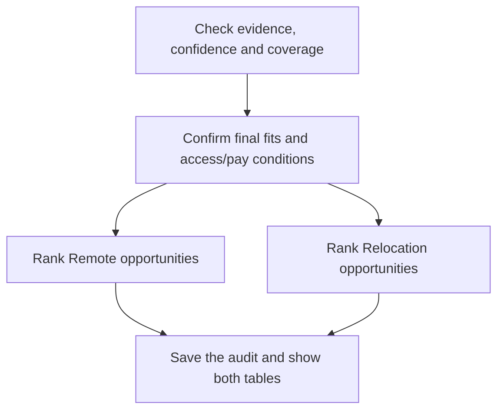

# Step 6: Final ranking



Audit the assessments and rank Remote and Relocation separately. Each table helps decide where to apply and what to verify first.

## Flow

## What the audit protects

The audit checks confidence, coverage of your confirmed country scope and evidence use. Missing evidence does not become Weak fit. Explicit exclusions retain their reasons, and each track stands independently.

Expected research that was not performed needs recovery. Completed checks can still leave an unresolved finding; the report names the gap without inventing a recommendation.

## Priority Table

The saved section contains two tables: Remote priorities and Relocation priorities. Each country appears once in each, with fit, confidence, main limitation and next action.

| Priority | How to use it |
|---|---|
| 🥇 Focus | Concentrate applications on the strongest supported opportunities. |
| 🥈 Selective | Apply to well-matched openings in a narrower market. |
| Investigate next | Verify material access or pay conditions in a promising market. |
| 🥉 Monitor | Set alerts for occasional opportunities with known limitations. |
| 🎗️ Deprioritize | Spend little application effort on this track's Weak or Excluded fit. |
| Pending evidence | The track remains unscored; resolve the named research gap. |

Focus, Selective and Monitor require Strong/Moderate fit and supported access. If a hard salary floor applies, they also require supported pay feasibility. Investigate next retains a supported fit while important conditions remain unverified. These are effort priorities, not offer probabilities.

Fictional track examples:

| Country | Priority | Fit | Confidence | Main limitation | Next action |
|---|---|---|---|---|---|
| 🏳️ Example A | 🥇 Focus | Strong | High | None identified | Target matching senior roles |
| 🏳️ Example B | 🥈 Selective | Moderate | Medium | Small relevant employer pool | Apply to the identified employer cluster |
| 🏳️ Example C | Investigate next | Moderate | Medium | Thailand eligibility unverified | Check the employer's country policy |
| 🏳️ Example D | Investigate next | Moderate | Low | Comparable base pay unpublished | Verify the role's pay range |
| 🏳️ Example E | 🥉 Monitor | Moderate | Medium | Few current openings | Set role-specific alerts |
| 🏳️ Example F | 🎗️ Deprioritize | Weak | Medium | Material role mismatch | Prioritize closer markets |
| 🏳️ Example G | 🎗️ Deprioritize | Excluded | Not assessed | Confirmed timezone constraint | Use the other track if supported |
| 🏳️ Example H | Pending evidence | Unknown | Not assessed | Relevant market evidence unusable | Resolve the cited source gap |
| 🏳️ Example I | Pending evidence | Unknown | Not assessed | Research rejected at validation | Repair the missing source field |

Order is independent in each table. Supported opportunity determines order within assessed priorities; alphabetical order is the last tie-breaker. Pending evidence is alphabetical.

## What is saved

`country-finder-06-final-results.md` contains the audit, recalibration, Summary, both priority tables and effort guidance. Chat shows the two tables and completion message. Research and Step 5 remain unchanged; completed older runs replay their saved format.

## Using the result

The post-audit Summary owns final fits. [Salary Calculator](../salary-calculator/step1-research-prompt-generator.html#choosing-countries) can reuse the full researched country scope without inheriting those fits. A separately verified compatible final can supply Relocation priorities for presentation order, with legacy combined-table support. [Portal Finder](../portal-finder.html) can investigate job boards for a country you choose.
