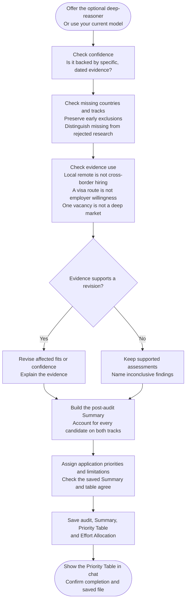

# Step 6: Final ranking

Audit the assessments and assign practical application priorities. This step runs even without a specialist.

## Flow

## What the audit protects

Confidence, missing candidates and evidence use receive separate checks. Early exclusions keep their reasons; missing, rejected or invalidated research does not become Weak fit. Each track stands independently.

Revisions need evidence. Material profile changes or contradicted exclusions return for a repair choice rather than silently changing earlier work.

## Priority Table

- 🥇 Focus: concentrate effort on the strongest supported opportunities.
- 🥈 Selective: target well-matched openings in a narrower market.
- 🥉 Monitor: watch for occasional opportunities despite substantial limitations.
- 🎗️ Deprioritize: both tracks are known Weak or Excluded.
- Pending evidence: neither track is Strong/Moderate and at least one is Unknown.

The first three need a Strong or Moderate track. Priorities consider your fit, opportunities, accessibility, pay and evidence; they are not probabilities or a formula.

Fictional examples:

| Country | Priority | Remote Fit | Sponsorship Fit | Main limitation |
|---|---|---|---|---|
| 🏳️ Example A | 🥇 Focus | Strong | Moderate | None identified |
| 🏳️ Example B | 🥈 Selective | Weak | Strong | Sponsorship: limited relevant openings |
| 🏳️ Example C | 🥈 Selective | Strong | Unknown | Sponsorship: research missing |
| 🏳️ Example D | 🥉 Monitor | Moderate | Moderate | Low current opportunity volume |
| 🏳️ Example E | 🎗️ Deprioritize | Weak | Weak | Few suitable openings on either track |
| 🏳️ Example F | 🎗️ Deprioritize | Excluded | Excluded | Remote: timezone limit; sponsorship: no eligible pathway |
| 🏳️ Example G | Pending evidence | Unknown | Weak | Remote: research missing |
| 🏳️ Example H | Pending evidence | Excluded | Unknown | Sponsorship: research rejected at validation |
| 🏳️ Example I | Pending evidence | Unknown | Unknown | Research not supplied for either track |

Within each assessed priority, supported opportunity determines order, with alphabetical order the last tie-breaker. Pending evidence is alphabetical. Main limitation gives a short reason or evidence gap; full details stay in the audit.

## What is saved

`country-finder-06-final-results.md` holds the audit, recalibration verdict, Summary, Priority Table and Effort Allocation. Every candidate is accounted for once per track, including exclusions and research gaps. A duplicate with a retained original is not missing.

Chat shows only the Priority Table and completion message. Unknown represents missing/unusable evidence; it does not imply a weak fit or recommended target.

## Using the result

The post-audit Summary records final fits. [Salary Calculator](../salary-calculator.html) selects eligible countries from it and uses the Priority Table for ordering.

Research and Step 5 stay unchanged. Completed runs replay saved results. See [Specialist agents]({{ '/docs/specialist-agents.html' | relative_url }}) for model choices.
