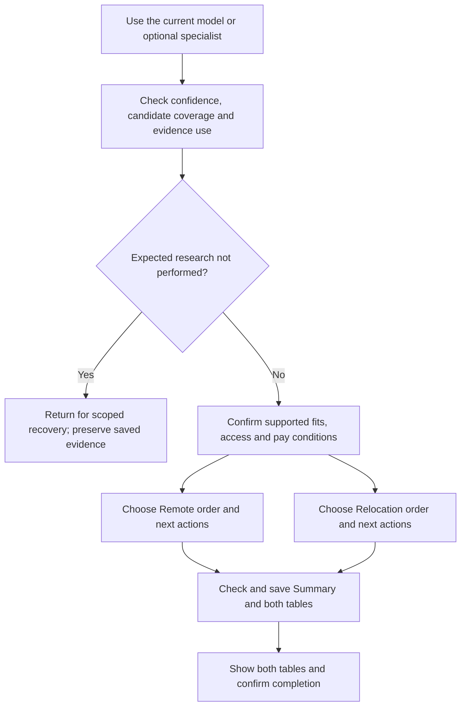

# Step 6: Final ranking



The final step checks whether the evidence supports the assessments, then produces independently ordered Remote and Relocation priorities. A promising market can remain worth investigating even when one employment condition is unresolved.

## Flow

## What the audit protects

Confidence calibration, missing candidates and evidence misuse receive separate checks. The audit distinguishes a statistical shortage, a legal route, employer willingness and an actual vacancy. One opening does not establish a deep market; absent sponsorship wording does not prove a country's employers refuse it.

Every candidate is accounted for on both tracks, including exclusions, rejected research and documented unresolved findings. Research that never ran requires recovery before completion. Older unfinished work that skipped discovery gaps needs an explicit repair choice before new research; completed results replay unchanged.

The audit can revise a fit when evidence warrants it. It retains the source research and Step 5 assessment as the earlier record. Material profile changes or contradicted exclusions return for a repair choice rather than silently changing the search.

## Priority Table

The existing saved section holds Remote priorities and Relocation priorities. Each table includes every country, its fit, confidence, main limitation and a concrete next action. Orders are independent: an unknown Remote track cannot hide a supported reason to deprioritize Relocation.

| Priority | Decision |
|---|---|
| 🥇 Focus | Strong/Moderate fit, supported access and feasible pay; the best-supported use of application effort. |
| 🥈 Selective | The same support requirements, with a narrower opportunity set or meaningful limitation. |
| Investigate next | Strong/Moderate fit with a material access or pay condition still unverified. |
| 🥉 Monitor | Supported fit, access and pay, but sparse openings or practical limitations favor alerts. |
| 🎗️ Deprioritize | This track is Weak or Excluded, independently of the other track. |
| Pending evidence | The track cannot be scored from usable evidence after research and recovery accounting. |

Pay feasibility does not require an actual offer: comparable market evidence can support it, and a hard floor is checked only where supplied. Unknown or incompatible pay remains unresolved. A country's lower living costs do not override your confirmed hard minimum.

For example, a relevant Laravel market and recurring English-language hiring can support Moderate fit while Thailand eligibility remains Unverified. Investigate next preserves that useful signal and names the policy to check. Focus requires supported accessibility and pay feasibility, while Pending evidence applies where the underlying opportunity itself cannot be assessed.

Fit and confidence are distinct. Scored fits carry High, Medium or Low confidence; excluded and unscored fits show Not assessed. Priorities allocate effort rather than estimate offer probabilities or combine factors into an invented numerical score.

Within assessed priorities, role/domain/level match, recurring opportunities, practical access, pay and confidence determine order. Alphabetical order is the final tie-breaker. Pending evidence stays alphabetical without an implied market ranking. The next action names the relevant employer/role cluster, verification, alert or research repair; it does not initiate contact automatically.

## What is saved

The final file contains the three audit checks, recalibration, authoritative Summary, both priority tables and effort guidance. Chat shows the two tables and completion message. Older combined-table results are preserved on replay.

Country Finder's [assessment framework](https://github.com/myowinthein/agent-compass/blob/main/skills/country-assessment-rules.md) draws on occupational classification, labour-market research and career guidance. General country-attractiveness rankings remain context: the [OECD methodology](https://www.oecd.org/en/data/tools/talent-attractiveness-research--methodology.html) assumes an existing suitable offer when assessing skilled-worker access, so it cannot supply your personal probability of obtaining one.

## Using the result

[Salary Calculator](../../salary-calculator/step1-research-prompt-generator.html#choosing-countries) still selects compatible countries from the post-audit Summary. It uses the new Relocation table for local-employee salary ordering, or the combined table in a legacy result. Missing ordering never blocks a standalone calculation. Portal Finder can investigate job boards for a selected country.

## Explore the source

Read [prompts/country-finder/step6-final-ranking.md](https://github.com/myowinthein/agent-compass/blob/main/prompts/country-finder/step6-final-ranking.md) for the exact final-output procedure.
