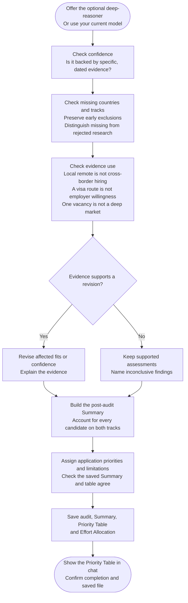

# Step 6: Final ranking



The final step checks the assessments before translating them into application priorities. It asks whether the evidence, confidence and candidate coverage justify the conclusions, including cases that remain unresolved.

## Flow

## What the audit protects

Confidence calibration, missing candidates and evidence misuse receive separate checks. An optimistic label needs supporting evidence; absence of evidence is not a reason to relabel a track Weak. Early exclusions keep their reasons and remain independent by track.

Every candidate is accounted for, including rejected research and retained duplicate originals. Material profile changes or evidence contradicting an earlier exclusion need a repair choice. Revisions are supported by evidence rather than made simply to produce a tidy ranking.

The final audit runs even when you decline a specialist. It does not overwrite the original research or the earlier scoring report.

## Priority Table

| Priority | How to read it |
|---|---|
| 🥇 Focus | Concentrate effort on the strongest supported opportunities. |
| 🥈 Selective | Target well-matched openings in a narrower market. |
| 🥉 Monitor | Watch for occasional opportunities despite substantial limitations. |
| 🎗️ Deprioritize | Both tracks are known Weak or Excluded. |
| Pending evidence | Neither track is Strong/Moderate and at least one is Unknown. |

The first three require at least one Strong or Moderate track. They reflect fit, opportunity, accessibility, pay and evidence, not a numerical formula or probability of success.

For example, Strong Remote and Unknown Sponsorship can still support an assessed priority, with the sponsorship gap visible. Unknown Remote and Weak Sponsorship instead remain Pending evidence. Two known exclusions support Deprioritize rather than pretending research is merely missing.

Within an assessed priority, supported opportunity determines ordering, with alphabetical order as the last tie-breaker. Pending evidence is alphabetical. Main limitation gives a short reason or evidence gap; the report retains the fuller explanation.

## What is saved

The final file contains the audit, recalibration verdict, Summary, Priority Table and Effort Allocation. Chat presents the compact Priority Table and completion message. A completed run replays these saved results rather than silently conducting a new search.

The post-audit Summary owns final fits. Priority Table order helps present them, but does not replace the Summary's conclusions or convert Unknown into a positive recommendation.

## Using the result

[Salary Calculator](../../salary-calculator/step1-research-prompt-generator.html#choosing-countries) can select compatible countries from the final Summary and use the Priority Table for ordering. Its own research and calculation rules still apply. Portal Finder can investigate job boards for one country you choose.

Treat the result as an evidence-backed allocation of effort for this candidate and snapshot. New facts can justify a fresh or repaired search; the previous files remain useful history.

## Explore the source

For implementation details, read [prompts/country-finder/step6-final-ranking.md](https://github.com/myowinthein/agent-compass/blob/main/prompts/country-finder/step6-final-ranking.md).
