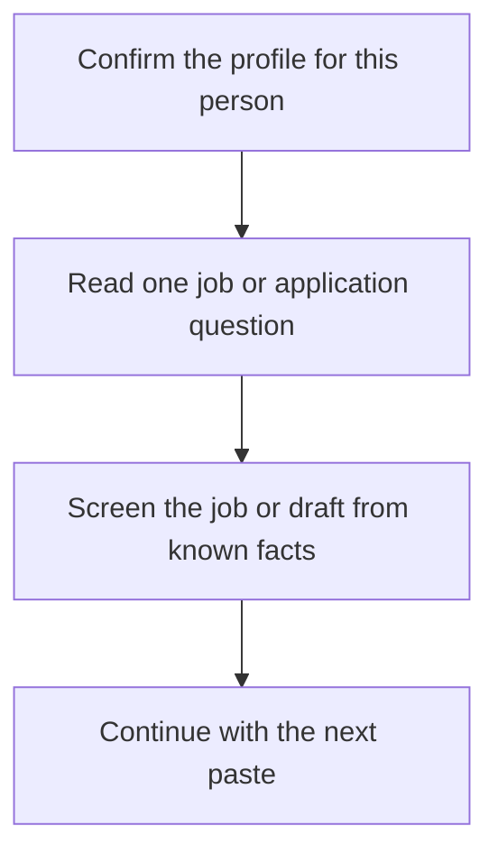

# job-screener



Compare job descriptions with your profile and receive an Apply, Maybe or Skip report. You can also request application drafts.

## Flow



## Start the command

```text
job-screener
```

Use the prefix from [Setup]({{ '/docs/setup/' | relative_url }}#run-a-command). Run once in a dedicated chat, then paste one job at a time.

## Your result

Each report gives a verdict, pros, cons and missing information. Salary and application method appear only when stated. 🚫 marks confirmed hard blockers, not every profile gap.

Saved situational facts are reused without requiring new intake. Drafts use confirmed facts and compact English; nothing is submitted automatically.

The profile is stored at `<home>/Agent Compass/runs/chat-…/run-…/profile.md`. New chats and different people start separate sessions. The old top-level profile is never reused automatically. Screening results stay in chat.

See [Match analysis](job-screener/step1-match-analysis.html) for verdict rules and the exact report format.

## Continuing the chat

Keep pasting jobs or application questions in the selected run. Each job is assessed independently without a checkpoint. Re-invoking the command for this person offers Continue screening / Start fresh, or Resume setup / Start fresh if intake is unfinished. Starting fresh preserves earlier profiles. There is no completed-search state or saved screening report to replay.
