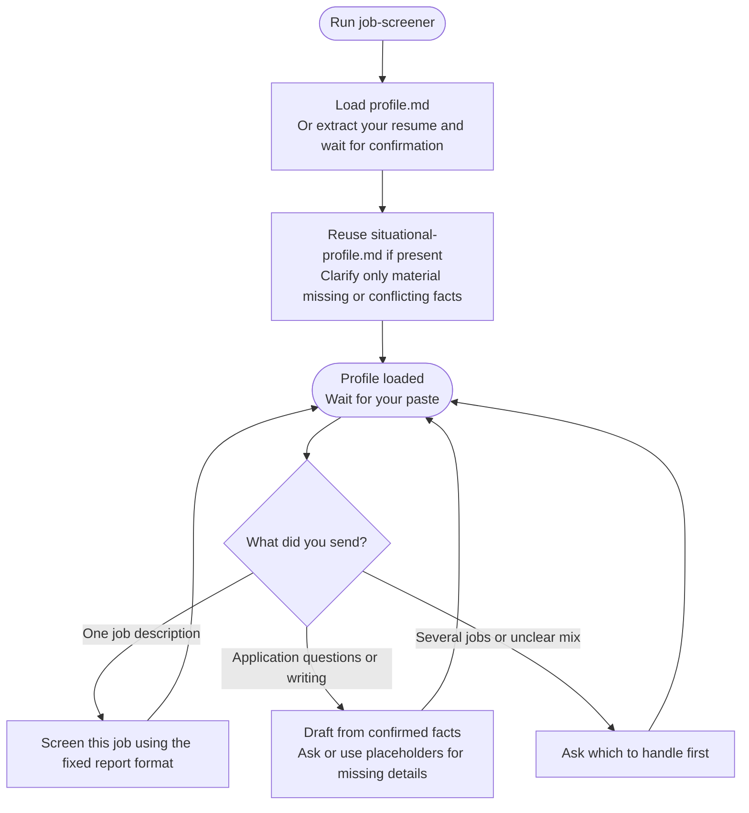

# job-screener

Compares job descriptions with your profile and returns a compact Apply, Maybe or Skip report. It can also help draft application answers and messages.

## Start the command

```text
job-screener
```

Use the prefix shown in [Setup]({{ '/docs/setup/' | relative_url }}).

A dedicated chat is useful. Run the command once, then paste one job description at a time. You do not need to repeat it for every job in that chat.

## Flow



## Your result

Each job gets a verdict, pros, cons and missing-information checklist. Salary and application method appear only when the job states them. 🚫 identifies a confirmed hard blocker, not every gap in your profile.

An existing situational profile supplies known work rights, location, languages and salary preferences. You do not need to complete a separate intake just to screen a job.

Application drafts use your confirmed facts and simple, compact English. The command does not submit applications automatically.

See [Step 1: Match analysis](job-screener/step1-match-analysis.html) for verdict rules and the report format.

## Continuing the chat

There is no checkpoint file; each job is assessed independently. Keep pasting jobs or application questions in the same chat. If the format drifts, run the command again to reload its instructions and profile.
