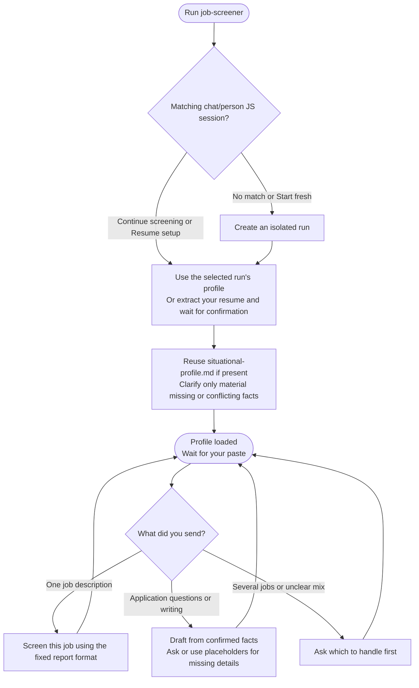

# job-screener



Job Screener compares one opportunity at a time with a confirmed candidate profile. It gives a compact Apply, Maybe or Skip report and can help draft application answers without inventing experience or submitting anything.

## Flow

## Start the command

Use a dedicated chat, run job-screener and confirm the resume extraction if the selected person has no profile yet. Once setup is ready, paste one job description or application question at a time.

A new chat or a different person gets a separate run. A replacement resume or a different profile version starts a fresh run while preserving the earlier profile. Ordinary follow-up questions about a job stay in the selected run instead of restarting intake.

## Your result

The report gives a verdict, pros, cons and missing information. Salary and the application method are included only when stated. The format stays compact so repeated screening remains easy to compare.

The important distinction is between a mismatch and a confirmed hard blocker. A missing tool, unexplained visa status or unclear language level is not automatically a blocker. The 🚫 marker needs both an explicit mandatory condition and a confirmed candidate fact showing it cannot be met.

For example, a posting that strictly requires existing local work authorization can be a blocker when the confirmed profile says the candidate lacks it. Silence about sponsorship alone does not establish that conclusion. Unknowns should stay visible and influence the verdict without being presented as facts.

[Match analysis](step1-match-analysis.html#hard-blockers) explains the verdict and blocker rules, including how role fit, relevant strengths and uncertainty are balanced.

## Application drafts

You can ask for an answer, message or other application draft using confirmed resume and situational facts. Missing material details prompt a focused question or an appropriate visible placeholder. The workflow does not invent credentials, salary details or personal history to make a draft sound stronger.

Drafting remains separate from submitting a form or sending a message. Results stay in chat; there is no saved screening report or completed-search checkpoint.

## Continuing the chat

Keep pasting jobs or application questions in the selected run. Each new job is assessed independently; a favorable result for one employer does not transfer to the next.

Re-invoking the command offers Continue screening or Start fresh for a ready profile, or Resume setup or Start fresh when intake is unfinished. Existing situational facts are reused without unnecessary full intake. Material corrections to saved profile facts receive their own confirmation rather than being silently inferred from a job description.

## Explore the source

For implementation details, read [workflows/job-screener.md](https://github.com/myowinthein/agent-compass/blob/main/workflows/job-screener.md).
