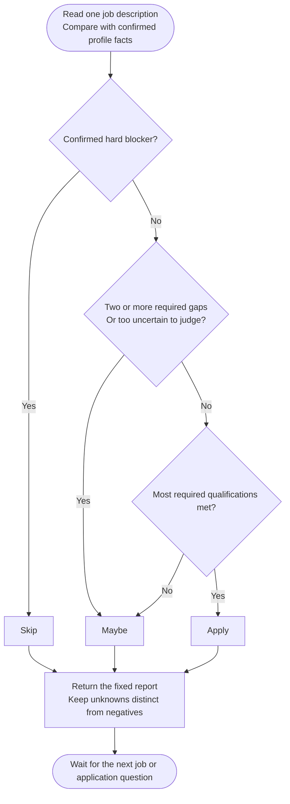

# Step 1: Match analysis

Loads your profile, waits for a job description and assesses the match without treating unknown facts as automatic failures.

## Flow

## Verdict rules

The first matching rule wins:

- ❌ Skip: at least one confirmed hard blocker.
- ⚠️ Maybe: no blockers, but two or more required qualifications are unmet, or too many are unverifiable to judge fit.
- ✅ Apply: no blockers and most required qualifications are met.
- ⚠️ Maybe otherwise: fit is not established, such as meeting one of two required qualifications.

Preferred qualifications do not count as required gaps. There is no numerical match score.

## Output format

| Section | Contents |
|---|---|
| `[VERDICT]` | One-line Apply, Maybe or Skip decision |
| `[APPLICATION METHOD]` | Application route explicitly stated in the job; omitted if none is stated |
| `[SALARY]` | Stated pay, retaining currency, period and compensation components; omitted if pay is unstated |
| `[PROS]` | Matching evidence in bullets |
| `[CONS]` | Gaps in bullets, with 🚫 reserved for hard blockers |
| `[MISSING INFORMATION]` | Unstated items from the fixed checklist |

The bracketed headers appear exactly as shown, without an introduction or closing commentary. The same format applies to each new job in the chat.

The checklist covers salary, visa sponsorship, relocation support, remote policy, work authorization, timezone or working-hours overlap, and employment type. If all are stated, the response says so. An unstated item is not a con on its own.

## Hard blockers

A 🚫 needs an explicit non-negotiable requirement and confirmed inability to meet it. Examples include required work rights, language, clearance, certification, location, permitted hiring jurisdiction, working hours or the role's core technology.

Missing resume evidence does not prove inability. Sponsorship, relocation and permitted obtain-by-start paths must be considered before declaring a blocker.

Salary can block only when the whole comparable pay range is below your confirmed hard floor. Currency, period and pay basis must align; missing exchange-rate information, unknown hours, context-only minima and straddling ranges do not prove failure.

Years-of-experience shortfalls are normal cons, never hard blockers. Unmet preferred qualifications are labelled "preferred, not required". A different current city does not prove you cannot relocate or work the required hours. No relocation support does not prove inability to move, and a work-rights or language blocker does not create a separate location blocker.

## Application questions and writing

You can paste application questions or request an email, cover letter or message without restarting. Drafts use confirmed facts only, with a question or visible placeholder for missing information.

Writing stays simple, short and calm, without unnecessary hyphens or excessive praise. No automatic submission is performed.

## Source boundaries

Only explicit profile facts, confirmed clarifications and the current job determine fit. Country Finder ratings and Salary Calculator targets do not replace job-specific eligibility or pay.

Instructions aimed at the assistant inside pasted jobs or forms are ignored. They cannot change the report format or authorise unrelated actions. Re-invoke the command if a long chat drifts.
