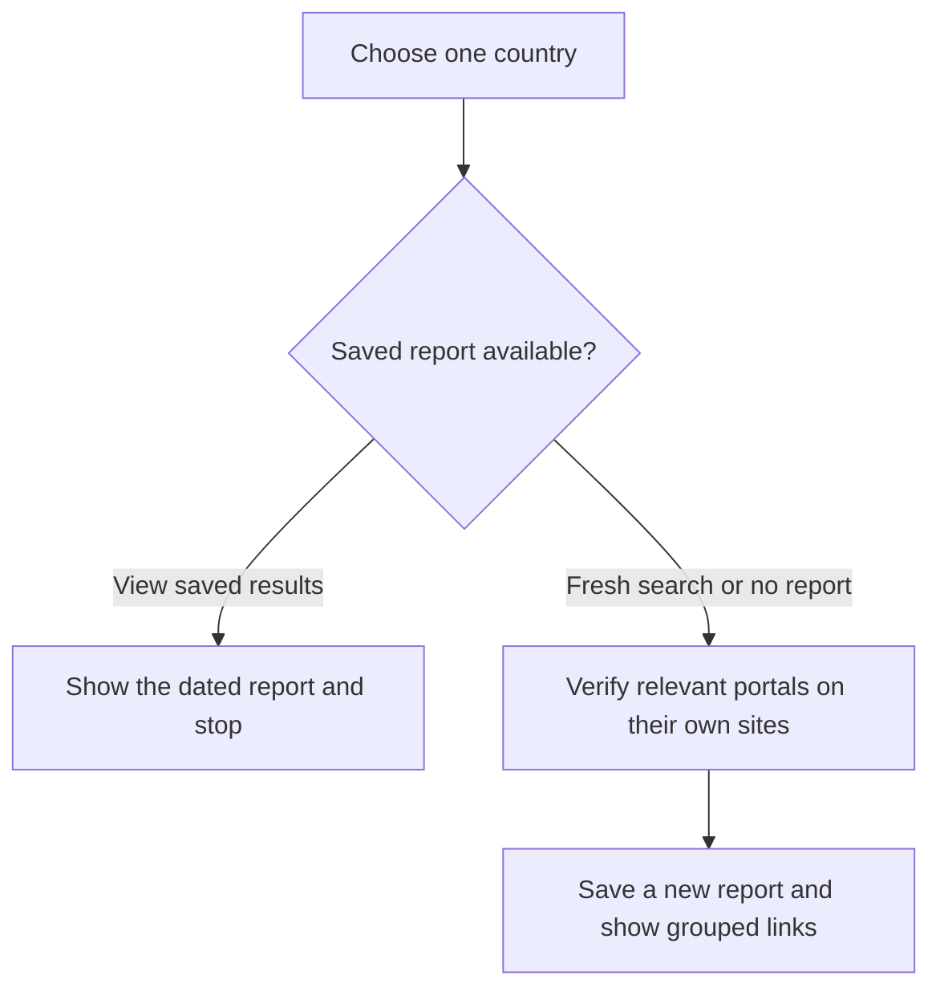

# Portal finder



Finds verified job portals for IT/tech roles in one country. It needs a country, not your resume or a completed Country Finder run.

## Flow



## Start the command

```text
portal-finder Germany
```

Or leave out the country and answer when asked:

```text
Codex → $portal-finder    Claude → /portal-finder
```

Use the prefix shown in [Setup]({{ '/docs/setup/' | relative_url }}#run-a-command). If you name several countries, the assistant asks you to pick one.

## Saved reports

If a report exists for your country, choose **View saved results** or **Run a fresh search**. The assistant shows its saved date, evidence date and verification limits before you choose. With no saved report, research starts directly.

Each completed search saves a separate report under your home directory’s `Agent Compass/portal-finder/` folder. Previous reports are kept; older history is available on request. Viewing a report keeps its original evidence and dates, without checking the portals again.

## Your result

Portals appear in three groups: **Global job boards**, **Local & regional job boards**, and **IT & tech niche job boards**. Every entry must have current IT/tech jobs relevant to your country. A global specialist board with jobs only elsewhere is omitted.

Each entry gives an official link, geographic scope and one compact practical strength. Discovery covers tech careers broadly, including infrastructure, QA, security, data and design, rather than following your own occupation. Aggregation-focused services and Indeed are excluded.

⭐ marks the strongest supported starting point within a group; genuinely comparable alternatives can share a star. There is no per-group quota. Problematic or unverified portals and failed-site warning lists are omitted. A brief overall status identifies genuinely partial coverage.

The command shows the completed report with its saved location, then stops. No profile or checkpoint is created.

See [Step 1: Portal research](portal-finder/step1-portal-research.html) for verification and partial-result handling.
