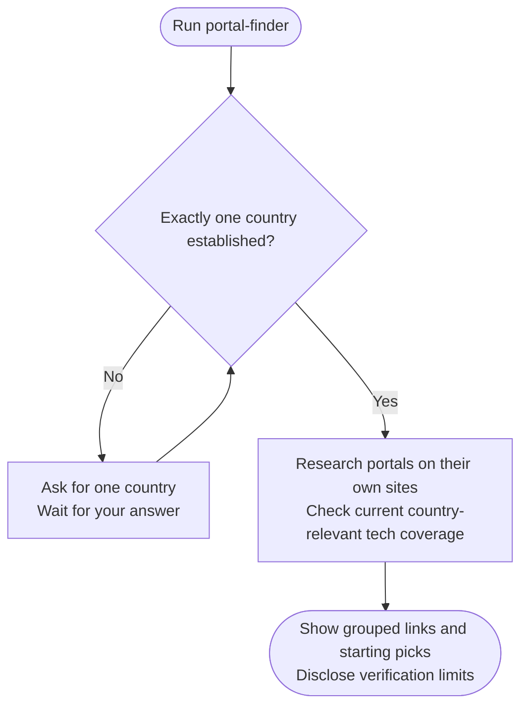

# portal-finder

Finds verified job portals for IT/tech roles in one country. It needs a country, not your resume or a completed Country Finder run.

## Start the command

```text
portal-finder Germany
```

Or leave out the country and answer when asked:

```text
portal-finder
```

Use the prefix shown in [Setup]({{ '/docs/setup/' | relative_url }}). If you name several countries, the assistant asks you to pick one.

## Flow



## Your result

Portals are grouped into general job boards, tech-specific boards, and professional or community networks. Each entry includes an official link, geographic scope and a short description.

⭐ marks verified starting picks. ⚠️ highlights access limits or other important caveats. A blocked or login-only site is not called dead merely because it could not be checked.

The command responds in chat and stops. It does not automatically create a result file or checkpoint.

See [Step 1: Portal research](portal-finder/step1-portal-research.html) for verification and partial-result handling.
