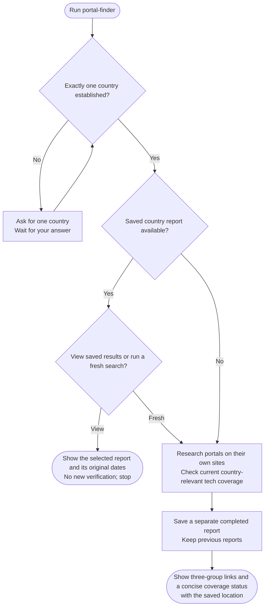

# Portal finder



Portal Finder gives you a verified starting list of places to search for tech jobs in one country. It examines the portals themselves and distinguishes useful current evidence from access problems or unsupported recommendations.

## Flow

## Start the command

Provide one country when starting portal-finder, or answer when asked. If several countries are named, choose one before research proceeds. No resume, profile extraction or completed Country Finder search is required.

This makes the workflow useful both after a broader country decision and for a quick independent search. The research still needs evidence for the chosen location; a familiar global brand is not automatically a useful local portal.

## Saved reports or fresh research

The assistant looks for the most recently saved report for the chosen country, including searches from earlier chats. If one exists, it shows when the report was saved, the date of its evidence and whether that evidence was live, supplied, mixed or unverified. Coverage limits remain visible. You can choose **View saved results** or **Run a fresh search**; a request that already makes that choice needs no repeated question.

Viewing shows the saved report unchanged and ends the command, including older group labels or warning notes. Its original date describes the earlier research; the portals have not been checked again. Older reports are available when you ask for them, while the normal choice stays focused on the latest saved report.

Every completed fresh search creates a separate report in your home directory’s `Agent Compass/portal-finder/` folder. Earlier reports remain available, even when the new search has narrower coverage or relies on supplied evidence. A completed search that verifies no portals is saved with that limitation; an unanswered research or access question remains unfinished.

Reports are grouped by country and need no resume or person selection. Claude and Codex on the same filesystem use the same home folder; a different machine or remote home has its own saved history.

## Your result

The three groups are **Global job boards**, **Local & regional job boards**, and **IT & tech niche job boards**. Country relevance comes first: each included portal needs current IT/tech vacancies for the country you chose. A remote label or international brand alone does not establish that coverage.

IT/tech-specialist boards and specialist job communities go in Niche, whether local or global. Other multi-career boards are split by their actual reach: many countries versus one country or a regional market. A global board's local edition stays Global. Remote-focused boards follow these same rules, and each portal appears once.

The search stays IT-wide rather than following your profile. A design-specific board can qualify alongside sources for QA, DevOps, database administration, support and other tech careers. An individual niche board does not need to cover every discipline.

Aggregation-focused services are excluded, including Indeed and its country editions. Direct employer, recruiter or community posting ecosystems are preferred. An application link to an employer website does not by itself make a board an aggregator, and genuine boards can still share some vacancies.

Each entry supplies an official link, geographic scope and a short practical strength. Stars identify the strongest supported starting points within each category. Comparable peers can share a star, but there is no fixed count: a verified entry is not automatically a top recommendation. Selection considers current country coverage, freshness, useful search tools and working job/application routes within the board's stated focus.

## When research is incomplete

Portals with broken, stale or unverifiable coverage are left out of the new live list, without a warning appendix naming failed candidates. Normal account creation to apply or save jobs is not itself a problem when relevant listings and a usable application route can be established. A restriction on one job does not establish a restriction on the whole portal.

Successful checks remain useful when another site fails. The report gives its verification date and, when access genuinely limited research, a brief overall partial-coverage status. It does not claim excluded sites are dead or that filtering aggregators makes the search incomplete.

When nothing qualifies, the result states that limitation clearly. Unavailable browsing retains the existing access/supplied-evidence route; an explicitly requested non-live assessment keeps its supplied evidence date and label, without stars implying live verification. [Portal research](step1-portal-research.html) explains the checks in more detail.

## After the result

The command replies in chat with the saved report’s location and stops. It creates no profile or checkpoint, and it does not apply for roles or contact portal operators. Run it again for another country when you want a separate list.

If saving fails, the completed result stays in chat with an explanation that it was not saved. Unreadable or changed saved files are reported for repair and preserved; they are never silently replaced by an older report.

## Explore the source

For implementation details, read [workflows/portal-finder.md](https://github.com/myowinthein/agent-compass/blob/main/workflows/portal-finder.md), [portal research rules](https://github.com/myowinthein/agent-compass/blob/main/prompts/portal-finder/step1-portal-research.md) and [saved-report storage](https://github.com/myowinthein/agent-compass/blob/main/skills/portal-results.md).
